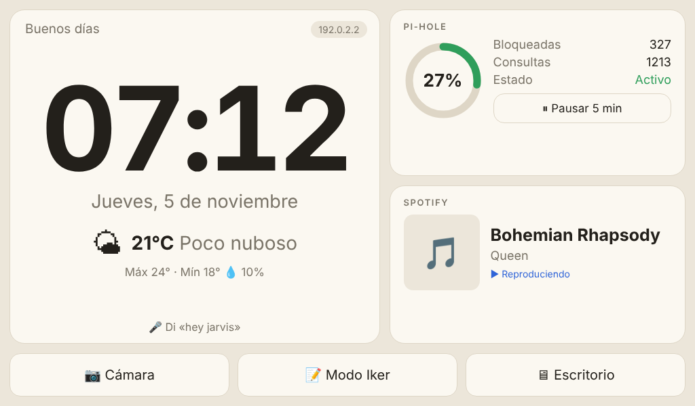
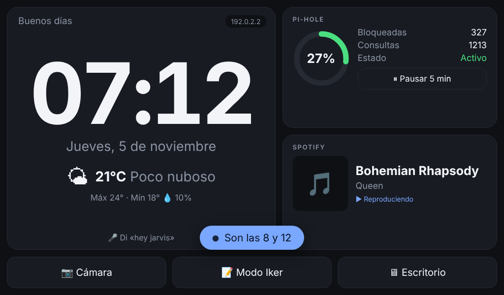

# PiCore

**Un PC portátil con Raspberry Pi 5 y pantalla táctil, con tres modos y todo en español: una pantalla de casa tipo Alexa (hora, tiempo, Pi-hole, música, voz sin nube), un bloc de notas con internet, y un modo para trastear.**

[](https://github.com/IkerPlays/PiCore/actions/workflows/test.yml)
[](https://picoreweb.netlify.app/)
-c51a4a?logo=raspberrypi&logoColor=white)


### [Web de PiCore: picoreweb.netlify.app](https://picoreweb.netlify.app/) · [Probar el simulador](https://picoreweb.netlify.app/simulador)

La web explica qué es PiCore, cómo funciona y para qué sirve, y el **simulador** es la misma interfaz que corre en la Pi, sin instalar nada (también desde el móvil). Es una simulación: no ejecuta nada real.

| Casa (claro) | Casa (oscuro) |
|---|---|
|  |  |

> El proyecto se llamaba «PCPi». Los nombres técnicos se mantienen por compatibilidad: comandos `pcpi-*`, carpetas `/opt/pcpi` y `/etc/pcpi`, archivo `pcpi.conf`, servicios `pcpi-home`/`pcpi-voice`/`pcpi-stats`.

## Los modos

| Modo | Qué hace |
|---|---|
| **Casa** | Estilo Alexa con animaciones suaves: hora, tiempo, Pi-hole, **Musix** (YT Music, MP3 Player y DYMusic), asistente de voz local, cámara, temporizadores, calendario y Wi-Fi |
| **Iker** | Bloc de notas (etiquetas, búsqueda, PDF, copias automáticas) e internet con marcadores |
| **Dev** | Consola de comandos (la ejecuta tu sesión, con tus permisos), terminal real, explorador de la API y experimentos que se encienden y apagan |
| **Escritorio** | Raspberry Pi OS normal |

## Documentación

- Qué comprar (menos de 250 euros): [docs/SHOPPING_LIST.md](docs/SHOPPING_LIST.md)
- **Tutorial desde cero (comprar, montar, instalar, configurar):** [docs/TUTORIAL.md](docs/TUTORIAL.md)
- Cómo funciona y hoja de ruta: [docs/ARCHITECTURE.md](docs/ARCHITECTURE.md)
- Demo web y cómo desplegarla: [docs/DEMO_WEB.md](docs/DEMO_WEB.md)
- Voz: [docs/VOICE.md](docs/VOICE.md) · Mini pantalla de estado (opcional): [docs/PANTALLA_MINI.md](docs/PANTALLA_MINI.md)
- Tus vídeos, GIFs e imágenes: [extra-assets/](extra-assets/README.md)
- Registro de cambios: [CHANGELOG.md](CHANGELOG.md) · Cómo colaborar: [CONTRIBUTING.md](CONTRIBUTING.md) · Seguridad: [SECURITY.md](SECURITY.md)

## Probar sin Raspberry Pi

**Opción 1 · Demo web (la más fácil).** <https://picoreweb.netlify.app/> — la interfaz con una API simulada en JavaScript, sin servidor. Con vídeos de inicio, GIFs e imágenes reales de `extra-assets/`.

```bash
make demo           # la misma demo en local: http://127.0.0.1:8081
```

En la demo funciona **casi todo lo visual**: Casa (reloj, tiempo, Pi-hole, temporizadores, Wi-Fi, brillo, Sistema), **Musix** (el MP3 Player suena con canciones generadas en el navegador; YT Music carga el reproductor de YouTube), el modo **Iker** con notas que se guardan en tu navegador y el modo **Dev** con una consola de mentira. **No hace nada real**: no apaga, no descarga, no ejecuta órdenes, no hay voz ni cámara real. Para ponerla tú en Netlify (3 pasos): [docs/DEMO_WEB.md](docs/DEMO_WEB.md).

**Opción 2 · Emulador completo (Python).** Con el servidor real y un Pi-hole falso:

```bash
make emulate        # o: python3 tools/emulate.py   (Windows: python tools\emulate.py)
```

Abre <http://127.0.0.1:8080> y tienes el modo Casa funcionando en tu ordenador con un Pi-hole falso, tiempo, cámara de prueba y dos canciones de prueba en Musix. En la misma terminal **escribes lo que dirías**: `oye pi qué hora es`, `/musica play Canción - Artista`, `/mode iker`... Usa el mismo código que la Pi real.

## Instalar

En Raspberry Pi OS con escritorio (64 bits), como usuario normal:

```bash
git clone https://github.com/IkerPlays/PiCore.git
cd PiCore
./install.sh --camera --voice   # Pi-hole se instala aparte: ./install.sh --pihole (ver Paso 6 del tutorial). Opciones: --all Aparte: --stats (mini pantalla), --battery y --ai
```

Después cierra sesión y vuelve a entrar. Para comprobar que todo va: `pcpi-doctor`. **Guía completa paso a paso: [docs/TUTORIAL.md](docs/TUTORIAL.md).** Para quitarlo: `./uninstall.sh`.

## Usar

```bash
pcpi-mode home      # modo Casa (también: iker, dev, desktop, status)
pcpi-wifi list      # Wi-Fi desde la terminal (connect, status, forget, pihole, portal)
pcpi-setup          # asistente: ciudad, contraseña de Pi-hole, micrófono (con prueba), mini pantalla
pcpi-doctor         # diagnóstico
pcpi-update         # actualizar PiCore (copia previa + git pull + reinstalar con tus opciones)
pcpi-backup create  # copia de seguridad de tu configuración, notas y extra-assets
pcpi-ask "pregunta" # preguntar a la IA local (si instalaste --ai)
```

También hay un icono **«PiCore · Elegir modo»** en el menú de aplicaciones, y botones táctiles dentro de la interfaz. El modo se recuerda entre reinicios. Configuración (Pi-hole, ciudad del tiempo): `/etc/pcpi/pcpi.conf`; hay una plantilla en [config/pcpi.conf.example](config/pcpi.conf.example).

## Más funciones

- **Musix**, el reproductor propio: **YT Music** (YouTube incrustado: pegas un enlace), **MP3 Player** (música offline en la Pi, importable desde un USB, con aleatorio y temporizador para dormir) y **DYMusic** (buscas una canción en YouTube y la web de conversión guarda el MP3 en el MP3 Player). Por voz: «pausa la música», «siguiente canción». Sin Premium ni cuentas.
- **Hoja «Sistema»**: disco, memoria, temperatura, avisos de salud, apagar/reiniciar con doble toque, y **actualizar desde la pantalla** (con registro; automático opcional por franja horaria, apagado por defecto).
- **Brillo** con modo noche automático (si la pantalla no tiene control por software, se oscurece con una capa), **vigilancia** por movimiento con la cámara (no guarda ni envía imágenes; apagada por defecto) y **batería** (solo con un UPS/HAT que la mida).
- **Tu ciudad desde la pantalla**: eliges la ciudad del tiempo escribiendo su nombre con el teclado en pantalla (sin editar coordenadas), y si el servidor se reinicia la interfaz muestra «Reconectando…» y se recupera sola.
- **Calendario** de solo lectura (`.ics` de Google/Apple), **tiempo** por horas y próximos días con aviso de lluvia, **salvapantallas** con tus fotos, **temporizadores y alarmas** por voz que persisten tras reiniciar.
- **Voz sin nube**: Whisper (modelo descargado al instalar) y palabra de activación dedicada. **IA local opcional** (`./install.sh --ai`: Ollama + Qwen, con datos reales de la Pi; ver el [tutorial 7.6](docs/TUTORIAL.md#76-ia-local-con-ollama--qwen-opcional) para lo que cabe de verdad).
- **Modo Iker**: buscar en las notas, **etiquetas** (`#compra`), **exportar a PDF**, **marcadores** de webs, copias automáticas y exportar a USB.
- **Autorreparación**: si Chromium se cae o se queda en blanco, se relanza solo por la pantalla de Carga.

## Pantallas de Inicio y de Carga

Al **encender**, una pantalla en blanco reproduce **uno de hasta 4 vídeos** de `extra-assets/start/` (`Inicio1.mp4`…`Inicio4.mp4`, al azar con pesos 90/85/55/1; el 4.º sale sí o sí tras 4 encendidos sin verlo y lleva un botón «Saltar» pequeño a los 6 s) y después carga el **último modo** usado. El vídeo 4 (~500 MB, no cabe en GitHub) **se descarga solo la primera vez que enciendes la Pi**, con pantalla de progreso. Si tus vídeos llevan H.265, `pcpi-intros check` / `pcpi-intros convert`. En **cada cambio de modo** (y tras el Inicio) sale la pantalla de **Carga**: pop-up «Cargando», barra y porcentaje, y debajo tus imágenes/GIFs/vídeos de `extra-assets/loading/`. La carga real llega al 100 % pero **se muestra 85 %**; entonces un efecto de tele con **«▶▶ x2»** acelera la barra hasta el 100 % (un tramo visual) y un botón **Saltar** lo pasa. Todo se ajusta en `[boot]`. Detalles: [extra-assets/README.md](extra-assets/README.md) y [Paso 8.2](docs/TUTORIAL.md#82-las-pantallas-de-inicio-y-de-carga-tus-vídeos-y-gifs).

## Wi-Fi

La wifi de casa va en la microSD (Imager). Para otra red, toca el icono de Wi-Fi del modo Casa (hay teclado en pantalla) o usa `pcpi-wifi`. **Pi-hole se aplica en cada red** (con un interruptor por red) y **no se fuerza si está caído**. En wifis públicas con portal (hotel, aeropuerto) se abre sola la ventana de inicio de sesión. Detalles y límites: [Paso 9](docs/TUTORIAL.md#paso-9-wi-fi-en-casa-de-viaje-y-wifis-públicas).

## Cámara

Con `--camera` (usa `ffmpeg`), el botón **Cámara** del modo Casa abre la imagen en pantalla completa, o di «Hey Jarvis», espera el pitido y «muestra la cámara» / «cierra la cámara». La cámara solo se enciende mientras la ves, solo se puede ver desde la propia Pi aunque el servidor escuche en la red, y se ajusta en `[camera]` de `/etc/pcpi/pcpi.conf`. Por defecto usa `/dev/video0` en 640×480 a 15 fps y copia el MJPEG de la webcam sin recodificar (casi sin CPU).

## Voz

Con `--voice` queda un asistente 100 % local (sin nube) con **detector dedicado de palabra de activación** ([openWakeWord](https://github.com/dscripka/openWakeWord)) + Vosk + espeak-ng. Di **«Hey Jarvis»**, espera el pitido y pide:

> «qué hora es» · «qué día es hoy» · «qué tiempo hace» · «modo casa / escritorio / iker» · «muestra la cámara» · «pausa el Pi-hole diez minutos» · «activa el Pi-hole» · «sube / baja el volumen» · «volumen al cincuenta» · «sube el brillo» · «brillo automático» · «activa la vigilancia»

La palabra, el umbral y el micro se cambian en `[voice]` de `/etc/pcpi/pcpi.conf`. Detalles, y por qué «Oye Pi» aún no es fiable: [docs/VOICE.md](docs/VOICE.md).

## Estado y honestidad

**Más de 590 tests** (`make test`, unos 7 minutos con los de navegador). Qué cubren:

- **Instalador y desinstalador ejecutados de verdad** en un árbol alternativo, con `apt`, `systemctl`, `sudo`... de mentira que anotan lo que se les pide: rutas, permisos, idempotencia (no pisa tu configuración ni tu modo) y orden de las llamadas.
- **Todos los scripts de `bin/`**, incluido el vigilante de modos con un Chromium de mentira.
- **Servidor y API**, seguridad (DNS rebinding, cabeceras, entradas raras), notas, cámara, configuración desordenada.
- **Voz** (intérprete de órdenes, máquina de estados), **mini pantalla**, Wi-Fi con `nmcli` simulado, pantallas de Inicio/Carga y assets.
- **«Pi virtual»** (`tests/test_pi_virtual.py`): el servidor real, `pcpi-session` real y un Chromium real sin pantalla recorren el encendido, el cambio de modo, DYMusic y el Modo Dev.
- **La interfaz en un navegador real** (Playwright) y **la demo web completa**. Se omiten si no tienes `node` + `playwright`.

> ⚠️ **Nada de esto se ha probado todavía en una Raspberry Pi real.** Falta comprobar sobre el hardware: el instalador con apt de verdad, el kiosco de Chromium (y el vídeo de Inicio con sus códecs), el Wi-Fi con NetworkManager y los portales cautivos reales, el la cámara, el reconocimiento de voz (calidad del micro, umbral de activación) y la mini pantalla. Si algo falla, `pcpi-doctor` y la sección «Si algo falla» del [tutorial](docs/TUTORIAL.md) son el punto de partida.

## Colaborar y licencia

Las ideas, los fallos y las mejoras son bienvenidos: mira [CONTRIBUTING.md](CONTRIBUTING.md). Para fallos de seguridad, [SECURITY.md](SECURITY.md).

**Licencia:** el código es **MIT** ([LICENSE](LICENSE)). Dos avisos para quien lo reutilice:

- Los vídeos, GIFs e imágenes de `extra-assets/` son **ejemplos del autor y no están cubiertos por la licencia MIT del código**: sustitúyelos por los tuyos (o comprueba sus derechos antes de reutilizarlos).
- El modelo `models/wake/oye_pi_experimental.onnx` es un experimento entrenado con las herramientas de openWakeWord. Según su documentación, **los modelos preentrenados de openWakeWord tienen licencia de uso no comercial (CC BY-NC-SA 4.0)**: si piensas usar PiCore en algo comercial, revisa las licencias de openWakeWord, Vosk, Whisper, Ollama y los modelos que instales; el código de PiCore no las incluye (se descargan al instalar).

**Gracias a** [openWakeWord](https://github.com/dscripka/openWakeWord), [Whisper](https://github.com/openai/whisper) / [faster-whisper](https://github.com/SYSTRAN/faster-whisper), [Vosk](https://alphacephei.com/vosk/), [Pi-hole](https://pi-hole.net/), [Ollama](https://ollama.com/) y [Qwen](https://github.com/QwenLM/Qwen2.5), [Open-Meteo](https://open-meteo.com/) y a Raspberry Pi.
