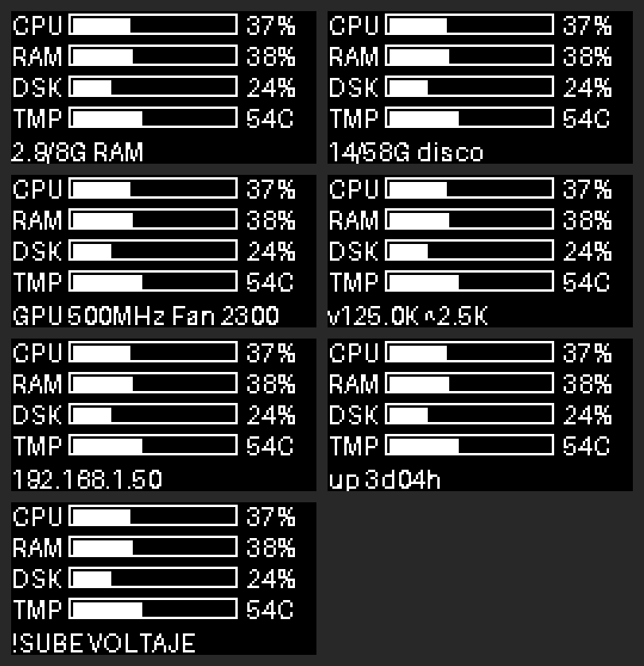

# Mini pantalla de estado (CPU · RAM · disco · temperatura · GPU)

> **¿Se puede? Sí.** La Raspberry Pi 5 tiene el hardware de sobra y el software ya está hecho y probado **sin la pantalla física** (ver [qué está probado](#qué-está-probado-y-qué-no)). Cuesta unos **7–15 €**. Se activa con `./install.sh --stats`.

Una pantallita **no táctil**, solo **texto blanco sobre negro** (sin colores ni barras), que se queda al lado de la grande. Las 6 líneas se ven a la vez y se actualizan cada segundo:



| Línea | Muestra |
|---|---|
| 1 | **CPU**: uso (%), temperatura y frecuencia |
| 2 | **RAM**: GB usados/totales y % |
| 3 | **DSK** (disco): GB usados/totales y % |
| 4 | **GPU**: frecuencia, y las **rpm del ventilador** |
| 5 | **NET**: velocidad de bajada (v) y subida (^). Si la Pi tiene **poca alimentación** o va **limitada por calor**, esta línea pasa a ser un aviso: `!VOLTAJE BAJO`, `!CPU LIMITADA` o `!DEMASIADO CALOR` (a la derecha en la imagen) |
| 6 | **IP** de la Pi y tiempo encendida |

> ℹ️ **Sobre la GPU:** la Pi 5 no ofrece un «% de uso de GPU» sencillo de leer. Se muestra la **frecuencia del V3D** (`vcgencmd measure_clock v3d`), que sube cuando la GPU trabaja y baja cuando está en reposo.

## Opciones de pantalla

| | **A. OLED 0,96" I2C (recomendada)** | B. LCD en color 1,3" SPI | C. Mini monitor HDMI 3,5" |
|---|---|---|---|
| Tamaño real | ~27 × 27 mm: **la más pequeña** | ~35 × 35 mm | ~85 × 55 mm |
| Resolución | 128×64, blanco sobre negro | 240×240, color | 480×320, color |
| Cables | **4** (3,3 V, GND, SDA, SCL) | 7–8 | HDMI (2.º micro-HDMI) + USB |
| Precio | **~5–8 €** | ~10–20 € | ~30–50 € |
| Software en este repo | ✅ **hecho** | ❌ no (habría que añadirlo) | ❌ no (habría que añadir una página y colocar la ventana en la 2.ª salida) |
| Pega | Solo texto blanco, pequeño | Necesita `rpi-lgpio` en la Pi 5 | Ocupa el segundo HDMI y un USB |

**Es la A**, y es lo que pediste (solo texto blanco): la más pequeña, la más barata, la más sencilla de conectar (I2C, 4 cables) y la única con software hecho. **No hace falta la versión en color.**

### Qué comprar (la elegida: HiLetgo)

| Pieza | Enlace | ~€ |
|---|---|---|
| **Pantalla OLED HiLetgo 0,96" I2C, 128×64** | [HiLetgo I2C (ASIN B06XRCQZRX)](https://www.amazon.es/HiLetgo-SSD1306-I2C-Serial-12864/dp/B06XRCQZRX) | ~7 |
| **Cables Dupont hembra–hembra** de 20 cm (el kit trae 40; usas 4) | [varias opciones](SHOPPING_LIST.md#cables-dupont-opciones-elige-el-que-te-deje-comprar-en-canarias) | ~5–11 |

> ⚠️ **En la ficha elige el color «White-IIC»** (según la ficha, es una de las opciones del selector; si no la ves, elige otra pantalla blanca de la lista).
>
> Aviso del color: Por defecto sale *Yellow Blue* (los primeros 16 píxeles de altura amarillos y el resto azules, de fábrica y sin remedio por software). Con «White» todo sale blanco.
>
> ⚠️ **Elige la versión I2C («IIC»).** HiLetgo vende también una de **SPI** (otro producto, ASIN B06XRBTBTB) que **no** vale: tiene 7 pines.
>
> ℹ️ La ficha **no dice qué chip lleva**; según las opiniones, es un SSD1306. **Por si acaso, el software soporta los dos chips más habituales** (SSD1306 y SH1106): si la imagen sale desplazada 2 columnas, pon `chip = sh1106` (ver abajo).
>
> 🔌 **Cables:** hay seis opciones de vendedores distintos en [SHOPPING_LIST.md](SHOPPING_LIST.md#cables-dupont-opciones-elige-el-que-te-deje-comprar-en-canarias). Tienen que ser **hembra en los dos extremos**; solo necesitas 4.
>
> Los precios son aproximados y **no he podido comprobar el envío a Canarias**: mete tu código postal en la ficha antes de pagar. Alternativa: [AZDelivery](https://amazon.es/AZDelivery-Pantalla-Display-pulgadas-Raspberry/dp/B01L9GC470) (blanca y SSD1306 según su ficha).

### Otras opciones (no necesarias)

- LCD 1,3" 240×240 ST7789: [genérico para Pi 5](https://www.amazon.es/LCD-compatible-Raspberry-controlador-integrado/dp/B0F9T7DP56) o [Waveshare HAT 1,3"](https://www.amazon.es/Waveshare-1-3inch-LCD-Controller-Communicating/dp/B07FJQHVW8) (el HAT se enchufa **encima** de la Pi: no sirve para ponerlo al lado de la pantalla).
- Mini monitor HDMI 3,5" 480×320: [Waveshare](https://www.amazon.es/Waveshare-Raspberry-LCD-Controlled-HDMI/dp/B071NVW7Y7) o [Kuman SC6AC](https://www.amazon.es/Kuman-Raspberry-Generation-Pulgadas-Pantalla/dp/B07PT3XGKJ) (el táctil no se usa como monitor).

Si algún día quieres otra, el trabajo que falta es un driver nuevo; el recolector de datos (`stats/sysstats.py`) se reutiliza tal cual.

## Conexión (opción A)

> 📖 **La guía paso a paso, con fotos del proceso en texto, cómo separar los cables del kit y qué comprobar, está en el [Paso 8 del tutorial](TUTORIAL.md#paso-8-mini-pantalla-de-estado-opcional).** Aquí va el resumen.

Con la Pi **apagada y desenchufada**. Cuatro cables Dupont hembra–hembra desde la pantalla a la tira de 40 pines (GPIO) de la Pi. Se usan solo pines **impares** (los de una misma fila), para no tocar nunca los de 5 V (2 y 4):

| Pantalla | Pin de la Pi | Qué es |
|---|---|---|
| **VCC** (o VDD) | **1** | 3,3 V |
| **SDA** | **3** | GPIO 2 (SDA) |
| **SCL** | **5** | GPIO 3 (SCL) |
| **GND** | **9** | Tierra |

```
        Primeros 10 pines de la tira (en la placa está en horizontal; aquí, en vertical):

                       fila de       fila de
                       impares       pares
          3,3 V  ───►   1  ■  ●  2   (5 V: NO tocar)
          SDA    ───►   3  ●  ●  4   (5 V: NO tocar)
          SCL    ───►   5  ●  ●  6
                        7  ●  ●  8
          GND    ───►   9  ●  ● 10

          ■ = pin 1 (pad cuadrado, normalmente en el extremo más cercano a la microSD)
```

⚠️ **VCC siempre al pin 1 (3,3 V), nunca a 5 V:** con la pantalla alimentada a 5 V, sus líneas de datos podrían subir a 5 V y dañar la Pi, cuyos GPIO son de 3,3 V. **El orden de los pines de la pantalla cambia según el fabricante**: lee las letras de tu placa.

> 🧰 Si el **GPIO queda tapado por la caja** de la Pi, usa una caja con el GPIO abierto o saca los cables por una ranura. Con 20 cm de cable puedes dejar la pantalla pegada al marco de la grande con **cinta de doble cara**.

## Instalación

1. Conecta los cables (arriba) y **enciende** la Pi.
2. Desde la carpeta del proyecto:

```bash
cd ~/PCRaspberryPI5 && git pull
./install.sh --stats
sudo reboot
```

El instalador activa el bus I2C (`raspi-config nonint do_i2c 0`), instala `python3-pil` y `python3-smbus`, te añade al grupo `i2c` y crea el servicio `pcpi-stats`. **Hace falta reiniciar.**

3. Comprueba que la ve: `sudo i2cdetect -y 1` debe mostrar **`3c`** (o `3d`) en la tabla.
4. Comprueba el servicio: `systemctl status pcpi-stats` y `pcpi-doctor`.

## Ajustes (`/etc/pcpi/pcpi.conf`, sección `[mini]`)

| Ajuste | Qué hace |
|---|---|
| `address = 0x3C` | Dirección I2C. Si `i2cdetect` muestra `3d`, pon `0x3D`. |
| `chip = ssd1306` | Si la imagen sale **desplazada 2 columnas** o con basura en el borde, tu pantalla lleva un **SH1106**: pon `chip = sh1106`. |
| `rotate = true` | Gira la imagen 180° (si la pantalla queda boca abajo). |
| `contrast = 120` | Brillo (0–255). Baja para que dure más. |
| `off_from` / `off_to` | **Apagado por horas** (p. ej. `1` y `7` = apagada de 1:00 a 7:00). Los OLED se «queman» si muestran lo mismo durante años; esto alarga su vida. |

Tras cambiar algo: `sudo systemctl restart pcpi-stats`.

## Qué está probado y qué no

| | |
|---|---|
| ✅ Probado con tests | Lectura de métricas (CPU, RAM, red, vcgencmd…), el contenido de cada línea, que **ninguna línea se sale de la pantalla ni se pisa** (ni siquiera con valores enormes), **conversión a los bytes del SSD1306** (posición de cada píxel), secuencia de arranque y escritura de la imagen entera (con un bus I2C simulado), apagado por horas. 18 tests. |
| ✅ Probado visualmente | El diseño: ver la imagen de arriba. Salida real de `python3 stats/miniscreen.py --backend png --once`. |
| ⚠️ **NO probado en hardware** | Que la pantalla real encienda y se vea bien. Lo escribí siguiendo el protocolo estándar del SSD1306 y del SH1106, pero no he podido tocar una. Si sale desplazada, en blanco o a rayas, mira abajo. |

## Si algo falla

| Síntoma | Causa probable |
|---|---|
| `i2cdetect` no muestra nada | Cables mal (VCC/GND al revés pueden dañarla), I2C no activado (`sudo raspi-config` → Interface → I2C), o falta reiniciar. |
| Se ve pero **desplazada 2 columnas** / basura en el borde | Tu chip es **SH1106**: pon `chip = sh1106` en `[mini]` y `sudo systemctl restart pcpi-stats`. |
| Se ve **boca abajo** | `rotate = true`. |
| Todo en blanco o a rayas | Prueba `address = 0x3D`; revisa SDA/SCL (no intercambiados). |
| El servicio da *Permission denied* en `/dev/i2c-1` | Cierra sesión o reinicia: el grupo `i2c` se aplica al iniciar sesión. `id` debe listar `i2c`. |
| Quiero ver el diseño sin pantalla | `make mini-preview` (genera `preview.png`). |

## Rendimiento

**Resistencia a fallos:** si la pantalla no está conectada al arrancar, o se suelta un cable, el servicio **no se cae**: avisa en el registro y reintenta cada pocos segundos. Si falta `python3-smbus` se detiene (no reintenta, porque no ayudaría) y lo dice.

El servicio corre con prioridad baja (`Nice=15`) y actualiza una vez por segundo. Lee unos pocos ficheros de `/proc` y `/sys`; lo único que lanza procesos es `vcgencmd` (GPU y alimentación), y solo cada 5 s. Medido en un PC de pruebas: **2,6 ms por actualización** (leer métricas + dibujar + convertir), es decir, ~0,3 % de un núcleo a 1 actualización por segundo. En la Pi 5 será más lento; **no lo he medido allí**.
