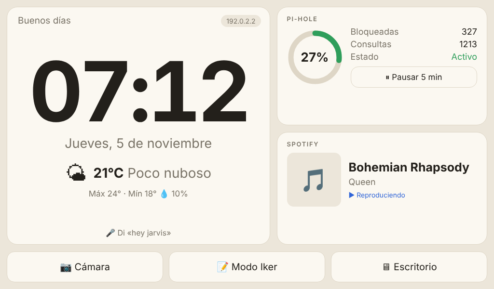
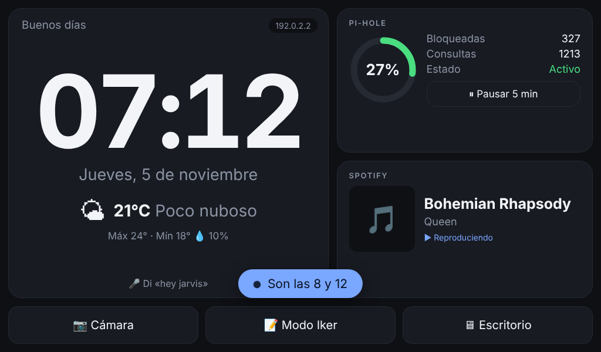
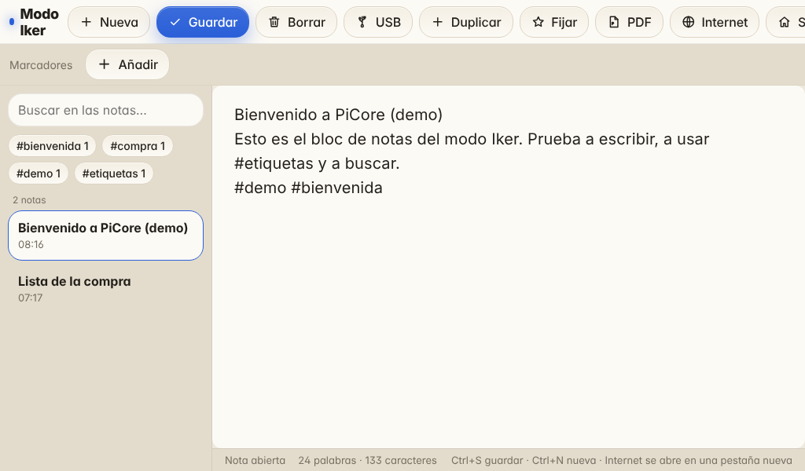
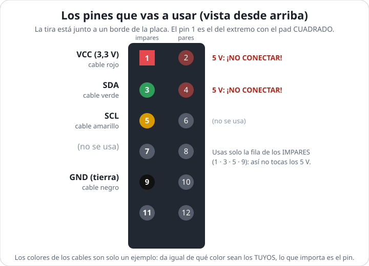
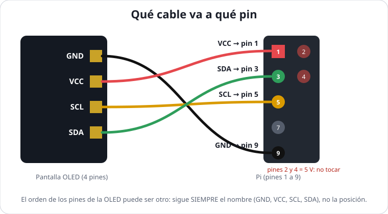

# Tutorial: de cero a tu PC con Raspberry Pi 5

Esta guía te lleva de la **caja cerrada** a tener funcionando los tres modos: **Escritorio**, **Iker** (notas + internet) y **Casa** (pantalla tipo Alexa con voz). No hace falta experiencia previa: cada paso dice **qué hacer**, **cómo comprobar que salió bien** y **qué mirar si no**.

| Símbolo | Significa |
|---|---|
| ✅ | **Comprobación**: así sabes que el paso salió bien. No sigas sin verla. |
| ⚠️ | Ojo: aquí es fácil equivocarse o romper algo. |
| 💡 | Truco opcional. |
| `texto en esta letra` | Se escribe tal cual en la terminal. |


## Resumen: 11 pasos, unas 3 horas

| # | Paso | Dónde | Tiempo |
|---|---|---|---|
| 0 | [Probar el proyecto sin hardware (opcional)](#paso-0-probar-sin-hardware-opcional) | tu PC | 5 min |
| 1 | [Comprar](#paso-1-comprar) | Amazon | — |
| 2 | [Preparar la microSD](#paso-2-preparar-la-microsd) (con tu Wi-Fi) | tu PC | 15 min |
| 3 | [Montar y conectar](#paso-3-montar-y-conectar) | mesa | 15 min |
| 4 | [Primer arranque](#paso-4-primer-arranque) | la Pi | 15 min |
| 5 | [**Meter el código en la Pi** e instalarlo](#paso-5-meter-el-código-en-la-pi-e-instalarlo) | la Pi | 20–30 min |
| 6 | [**Instalar y configurar Pi-hole**](#paso-6-instalar-y-configurar-pi-hole) | la Pi | 15 min |
| 7 | [Configurar PiCore](#paso-7-configurar-picore): música (Musix), tiempo, cámara, **voz** (con el asistente `pcpi-setup`) | la Pi | 20 min |
| 8 | [Usar los modos](#paso-8-usar-los-modos) y [las pantallas de **Inicio** y **Carga**](#82-las-pantallas-de-inicio-y-de-carga-tus-vídeos-y-gifs) | la Pi | 10 min |
| 9 | [**Wi-Fi** en casa, de viaje y wifis públicas](#paso-9-wi-fi-en-casa-de-viaje-y-wifis-públicas) | la Pi | 10 min |
| 10 | [Mini pantalla de estado: **conectar los cables Dupont** (opcional)](#paso-10-mini-pantalla-de-estado-opcional) | mesa + la Pi | 20 min |
| 11 | [Mantenimiento](#paso-11-mantenimiento) y [Si algo falla](#si-algo-falla) | | |

Al final tienes una [**chuleta de comandos**](#chuleta-de-comandos) y el [**Apéndice A: la terminal desde cero**](#apéndice-a-la-terminal-desde-cero) (léelo antes del Paso 5 si nunca has usado una).

> **Palabras que van a salir:** la **terminal** es la ventana negra donde se escriben órdenes. `sudo` ejecuta una orden como administrador (te pide la contraseña la primera vez; al escribirla **no se ve nada**, es normal). **SSH** es entrar en la Pi desde tu PC por la red. **microSD** es la tarjeta donde vive el sistema. **Pin / GPIO** son las patillas de la Pi donde se conectan cables. **Dupont** son esos cables de colores con un casquillo en la punta.

---

## Antes de empezar: lista de comprobación

Marca cada cosa antes de seguir; te ahorrará vueltas.

- [ ] Tengo la **Raspberry Pi 5** con su **fuente de 27 W**, el ventilador y la **microSD** (todo el kit).
- [ ] Tengo la **pantalla táctil de 7"** con sus cables, el **cable micro-HDMI**, la **cámara Logitech** y el **hub USB**.
- [ ] Tengo un **teclado USB** y un **ordenador** con lector de microSD (o adaptador).
- [ ] Tengo **internet** (wifi o cable) y sé la contraseña del wifi. *(Si vas a viajar con la Pi, no hace falta nada más: la wifi de casa va en la microSD y las demás se añaden desde la pantalla, [Paso 9](#paso-9-wi-fi-en-casa-de-viaje-y-wifis-públicas).)*
- [ ] *(Opcional)* Tengo la **mini pantalla OLED** y **4 cables hembra–hembra**.
- [ ] Tengo a mano un **papel y boli** para apuntar el usuario y las contraseñas que vayas creando.

> 🧰 **No hace falta ninguna herramienta** (ni destornilladores ni soldador): todo se conecta a presión. Lo único que necesitas es **paciencia con los cables**.

---

---

## Paso 0: probar sin hardware (opcional)

**Lo más fácil: la demo web.** Abre <https://picoreweb.netlify.app/> y ya está (si quieres ponerla tú en Netlify, en [docs/DEMO_WEB.md](DEMO_WEB.md) tienes los 3 pasos): es la misma interfaz funcionando en el navegador, sin instalar nada y también desde el móvil. Con `make demo` la ves en tu ordenador en <http://127.0.0.1:8081>. No ejecuta nada real. Para probar el **servidor de verdad** (voz simulada, Pi-hole falso, cámara de prueba), usa el emulador completo:

Antes de comprar nada puedes ver cómo se verá todo **en tu ordenador** (Linux, macOS, o Windows con WSL), con Python 3 instalado:

```bash
git clone https://github.com/IkerPlays/PiCore.git
cd PiCore
python3 tools/emulate.py        # Linux / macOS (también vale: make emulate)
```

En **Windows** no existe `make` ni `python3`; usa en su lugar (en `cmd` o PowerShell, dentro de la carpeta del proyecto):

```
python tools\emulate.py
```

(si `python` no se reconoce, prueba `py tools\emulate.py`, o instala Python desde <https://www.python.org/downloads/> marcando *Add python.exe to PATH*). Pensado para Linux/macOS; en Windows no está probado.

Abre <http://127.0.0.1:8080> en el navegador.

✅ Ves el modo Casa con un Pi-hole de mentira, el tiempo, dos canciones de prueba en Musix y (si tienes `ffmpeg`) la cámara. `http://127.0.0.1:8080/iker` es el bloc de notas.

**Para ver los intros y la pantalla de carga** (como al encender la Pi) abre <http://127.0.0.1:8080/loading?to=home&boot=1>. En la terminal del emulador: `/boot` = «encender de nuevo» (elige otro intro; **recargar la página de arranque también cuenta como encender de nuevo**), `/intro 1` … `/intro 4` fuerza uno (el 4 enseña también el botón «Saltar» a los 6 s), `/intro4 reset` vuelve a mostrar la pantalla de descarga, `/battery 15`, `/portal on`, `/motion` enseñan la batería, la wifi pública y el aviso de movimiento. El intro 4 se «descarga» de un servidor local con uno de tus vídeos como sustituto (para bajar el real, `--real-intro4`, unos 530 MB).

En la misma terminal puedes **escribir órdenes de voz**: `hey jarvis qué hora es`, `hey jarvis modo iker`, `hey jarvis muestra la cámara`. Usa el mismo código que la Pi. `Ctrl+C` para salir.

---

## Paso 1: comprar

**Presupuesto máximo: 250 € sin la Raspberry Pi. La lista cuesta unos 90 €.** Todo en Amazon.es, y todo lo de la lista te llega a casa.

| # | Pieza | Enlace | ~€ |
|---|---|---|---|
| 0 | **Kit Raspberry Pi 5 de 8 GB** (Pi + fuente 27 W + ventilador + disipador + microSD) | [tu kit](https://www.amazon.es/dp/B0CRPF47RG) | ya lo tienes |
| 1 | **Pantalla táctil 7" con altavoces** (1024×600, HDMI) | [GeeekPi 7" para Pi 5](https://www.amazon.es/GeeekPi-capacitivo-pulgadas-Raspberry-pantalla/dp/B0CKMDGFDR) | ~60 |
| 2 | **Cable micro-HDMI a HDMI** corto | [Silkland 0,3 m](https://www.amazon.es/Silkland-Cable-Micro-compatible-Ethernet/dp/B0D1TVFDT8) | ya lo tienes |
| 3 | **Cámara web con micrófono** (sirve de cámara **y** de micro) | [Logitech C270](https://www.amazon.es/Logitech-C270-Webcam-USB-negro/dp/B003R1O320) | 18–25 |
| 4 | **Hub USB 3.0** de 4 puertos | [UGREEN 15 cm](https://www.amazon.es/UGREEN-Velocidad-Adaptador-Compatible-Port%C3%A1til/dp/B0CD1BHXPZ) | ~10 |
| 5 | **Teclado USB** con cable | ya lo tienes | 0 |
| 6 | **Opcional:** mini pantalla de estado (ver [Paso 10](#paso-10-mini-pantalla-de-estado-opcional)) | [HiLetgo OLED I2C](https://www.amazon.es/HiLetgo-SSD1306-I2C-Serial-12864/dp/B06XRCQZRX) (⚠️ elige el color **White-IIC**) + [kit de cables Dupont SunFounder](https://www.amazon.es/SunFounder-Raspberry-Macho-Hembra-Macho-Macho-Hembra-Hembra/dp/B0772T35F4) | ~14 |

**Alternativas** por si alguna pieza no está disponible: [iPistBit 7"](https://www.amazon.es/iPistBit-Raspberry-altavoces-integrados-compatible/dp/B0D7HSXY37), [InnoMaker 7"](https://www.amazon.es/innomaker-Pantalla-capacitiva-altavoces-Raspberry/dp/B0FL6SVLS5), micro USB pequeño [SunFounder](https://www.amazon.es/SUNFOUNDER-Mini-micr%C3%B3fono-Escritorio-reconocimiento/dp/B01KLRBHGM). Más detalle en [SHOPPING_LIST.md](SHOPPING_LIST.md).

También necesitas (seguro que ya los tienes): un **ordenador** y un **lector de microSD** (o adaptador) para preparar la tarjeta, y **wifi** o un cable Ethernet.

✅ **Al recibir el pedido**, comprueba que el kit trae: la Pi 5 de **8 GB**, la **fuente USB-C de 27 W**, el ventilador con disipador y la **microSD**. Sin la fuente oficial la Pi 5 va corta de potencia.

---


## Paso 2: preparar la microSD

Esto se hace **en tu ordenador**, no en la Pi. ⚠️ Se borra todo lo que haya en la tarjeta.

1. Descarga e instala **Raspberry Pi Imager**: <https://www.raspberrypi.com/software/>.
2. Mete la microSD en el lector y conéctalo al ordenador.
3. Abre Imager y elige:
   - **Dispositivo:** Raspberry Pi 5
   - **Sistema operativo:** *Raspberry Pi OS (64-bit)*, el recomendado, con escritorio
   - **Almacenamiento:** tu microSD (⚠️ mira el tamaño para no elegir otro disco)
4. Cuando te ofrezca **personalizar** el sistema (*Editar ajustes* / *Customisation*), rellena **todo** esto. Así no tendrás que configurar nada a mano en la Pi:

| Ajuste | Qué poner |
|---|---|
| Nombre del equipo (hostname) | `pcpi` |
| Usuario y contraseña | el que quieras (por ejemplo `iker`). **Apúntalos** |
| Wi-Fi | nombre y contraseña de tu red; país **ES** (si usas cable, omítelo) |
| Zona horaria y teclado | zona `Atlantic/Canary` (Canarias) o la tuya; teclado `es` |
| SSH | **activado**, con contraseña |

> 📶 **La wifi que pongas aquí es la de casa.** Si luego viajas y te conectas a otra, **no hace falta tocar la microSD**: se cambia desde la pantalla de la Pi ([Paso 9](#paso-9-wi-fi-en-casa-de-viaje-y-wifis-públicas)), también wifis de hotel o aeropuerto con inicio de sesión. Pi-hole funcionará en todas.

5. Pulsa **Guardar → Sí** y espera a que escriba y verifique (5–10 min).

✅ Imager dice que terminó. Expulsa la tarjeta con seguridad y sácala del lector.

---

## Paso 3: montar y conectar

⚠️ **Todo desenchufado.** La corriente va lo último.

### 3.1 Ventilador y disipador

Si tu kit trae el *Active Cooler* (ventilador con disipador) y no viene ya puesto:

1. Alinea las dos patitas de plástico con los dos agujeros de la placa, junto al chip grande.
2. Presiona las dos patas hasta oír *clic*.
3. Conecta el cable fino del ventilador al conector pequeño de 4 pines rotulado **FAN** de la placa. Solo entra en una posición: no fuerces.

Si el kit trae **caja**, sigue sus instrucciones (algunas llevan su propio ventilador).

### 3.2 La microSD

La ranura está en la **cara inferior** de la placa. Inserta la tarjeta con los contactos hacia la placa hasta que encaje.

### 3.3 Conexiones

La Pi 5 **no tiene conector de auriculares**: el sonido va por el HDMI y suena en los altavoces de la pantalla.

```
                       ┌────────────────────────┐
   Teclado ───────────►│ USB                    │
                       │                        │
   Hub USB ───────────►│ USB 3.0 (azul)         │◄──────── Fuente USB-C 27 W  (LA ÚLTIMA)
      ├─ Cámara+micro  │                        │
      └─ (libre)       │    RASPBERRY PI 5      │◄──────── Ethernet (opcional)
                       │                        │
   Pantalla: táctil ──►│ USB                    │
   Pantalla: imagen ◄──┤ micro-HDMI 0           │
                       └────────────────────────┘
   Pantalla: cable de alimentación ──► un USB de la Pi (o un cargador de móvil de 5 V)
```

| # | Conecta | A |
|---|---|---|
| 1 | Cable **micro-HDMI** de la pantalla | puerto **HDMI0** de la Pi (el más cercano a la entrada USB-C de corriente) |
| 2 | Cable USB **táctil** de la pantalla | un USB de la Pi |
| 3 | Cable de **alimentación** de la pantalla | un USB de la Pi, o un cargador de móvil de 5 V si la Pi avisa de poca potencia |
| 4 | **Hub USB** | un USB **azul** (3.0) de la Pi |
| 5 | **Cámara Logitech** | al hub |
| 6 | **Teclado** | a la Pi o al hub |
| 7 | **Red** | wifi (ya configurado) o cable Ethernet |
| 8 | **Fuente de 27 W** | al USB-C de la Pi y a la pared. La Pi arranca sola |

> 💡 Consulta el manual de **tu** pantalla: cada modelo usa sus propios conectores para imagen, táctil y corriente. Lo habitual es un USB para el táctil y otro para la corriente.
>
> 📷 Pon la cámara encima de la pantalla, mirando hacia ti. Es también el micrófono.

✅ A los pocos segundos ves el logo de Raspberry Pi y después el escritorio.

---

## Paso 4: primer arranque

La primera vez tarda 1–2 minutos (ajusta el tamaño del sistema solo).

1. Abre una **terminal**: icono `>_` de la barra de arriba.
2. Actualiza el sistema (puede tardar 5–10 min):

```bash
sudo apt update && sudo apt full-upgrade -y
sudo reboot
```

3. Cuando vuelva a arrancar, comprueba internet: `ping -c 3 raspberrypi.com`.

✅ Salen 3 respuestas con tiempos (`time=...`).

| Problema | Solución |
|---|---|
| La imagen sale cortada o mal | *Menú → Preferencias → Screen Configuration* y elige `1024x600`. Si no ves nada, añade ` video=HDMI-A-1:1024x600@60` al **final de la única línea** de `/boot/firmware/cmdline.txt` (con la tarjeta en tu PC o por SSH). |
| El táctil no responde | Revisa el USB del táctil; prueba otro puerto o cable. |
| Sin wifi | Conecta un cable Ethernet o configura el wifi desde el icono de arriba a la derecha. |

---

---

## Paso 5: meter el código en la Pi e instalarlo

> 🎯 **Qué vas a hacer:** descargar el código del proyecto a la Pi y ejecutar un programa (el *instalador*) que lo deja todo listo. Son **4 órdenes** que copias y pegas. Si nunca has usado una terminal, lee antes el [Apéndice A](#apéndice-a-la-terminal-desde-cero) (5 minutos): explica qué es y cómo no perderte.

### 5.1 Qué es «el código» y de dónde sale

El código del proyecto vive en **GitHub** (una web donde se guardan proyectos), en <https://github.com/IkerPlays/PiCore>. Un programa llamado **`git`** sabe copiar ese proyecto a tu Pi: se llama *clonar*. No tienes que registrarte en nada.

Es **todo texto**: ni compilar ni nada raro. El instalador se encarga de ponerlo en su sitio (`/opt/pcpi`), crear los servicios y dejar el modo Casa preparado.

### 5.2 Abrir una terminal en la Pi (dos formas)

**Forma A: directamente en la Pi** (la más simple, la tienes delante)

1. Con el teclado USB conectado, pulsa en la barra de arriba el icono **`>_`** (*Terminal*).
2. Se abre una ventana negra con una línea que acaba en `$`, algo así: `iker@pcpi:~ $`. Ahí escribes. Esa línea se llama **prompt** y significa «estoy esperando una orden».

**Forma B: desde tu ordenador por SSH** (la más cómoda: puedes **copiar y pegar** los comandos desde esta guía)

1. En tu ordenador abre una terminal: en **Windows** busca *PowerShell* o *Terminal* en el menú Inicio; en **macOS** abre *Terminal*; en **Linux**, *Ctrl+Alt+T*.
2. Escribe (cambiando `iker` por **el usuario que pusiste en el Paso 2**) y pulsa `Enter`:

```bash
ssh iker@pcpi.local
```

3. La primera vez pregunta *«Are you sure you want to continue connecting?»*: escribe `yes` y `Enter`.
4. Te pide la **contraseña** de la Pi. ⚠️ **Al escribirla no se ve nada** (ni asteriscos): es normal. Escríbela entera y pulsa `Enter`.

✅ Si ves un prompt como `iker@pcpi:~ $`, **estás dentro de la Pi**. Todo lo que escribas ahora se ejecuta en ella.

| Si pasa esto | Haz esto |
|---|---|
| `Could not resolve hostname pcpi.local` | Tu ordenador no encuentra la Pi por nombre. Mira la IP de la Pi en la página de tu router (aparece como `pcpi`) o, en la Pi, escribe `hostname -I`, y usa `ssh iker@192.168.x.x` |
| `Connection refused` / `timed out` | La Pi aún arranca (espera 2 min), no está en la misma wifi que tu ordenador, o no activaste SSH en el Paso 2 |
| `Permission denied` | Usuario o contraseña mal. Ojo con mayúsculas; recuerda que al teclear la contraseña no se ve nada |
| `REMOTE HOST IDENTIFICATION HAS CHANGED` | Reinstalaste la microSD. En tu ordenador: `ssh-keygen -R pcpi.local` y vuelve a intentarlo |

### 5.3 Comprueba que la Pi tiene internet y hora correcta

```bash
ping -c 3 github.com
date
```

✅ `ping` debe mostrar 3 líneas con `time=… ms`, y `date` la fecha y hora de hoy. Si la hora está muy mal, algunas descargas fallan: `sudo timedatectl set-ntp true` y espera un minuto.

### 5.4 Descargar el código (`git clone`)

Copia estas tres órdenes, **de una en una**, y pulsa `Enter` después de cada una (en la terminal de la Pi se pega con `Ctrl+Shift+V`; en PowerShell, clic derecho):

```bash
sudo apt install -y git
git clone https://github.com/IkerPlays/PiCore.git
cd PiCore
```

Qué hace cada una:

| Orden | Qué hace |
|---|---|
| `sudo apt install -y git` | Instala el programa `git` (si ya está, dice *«ya está en su versión más reciente»*). `sudo` = «como administrador»; te pedirá la contraseña |
| `git clone …` | Descarga el proyecto en una carpeta nueva llamada `PiCore` |
| `cd PiCore` | **Entra** en esa carpeta (*change directory*). A partir de aquí estás «dentro» del proyecto |

Comprueba que estás dentro y que el proyecto está completo:

```bash
pwd          # dónde estoy
ls           # qué hay aquí
```

✅ `pwd` debe decir `/home/iker/PiCore` (con tu usuario) y `ls` debe listar, entre otros: `install.sh  home  bin  voice  config  docs  extra-assets`.

### 5.5 Ejecutar el instalador

```bash
./install.sh --camera --voice
```

⚠️ **Como tu usuario normal, sin `sudo` delante**: el script usa `sudo` solo en lo que lo necesita (y te pedirá la contraseña una vez).

Sale texto sin parar con títulos que empiezan por `==>`. Es normal: son las fases. **No cierres la ventana ni apagues la Pi.** Tarda **10–25 minutos** (lo que más tarda es descargar el modelo de voz, ~200 MB).

| Fase que verás | Qué está haciendo |
|---|---|
| `==> Comprobaciones previas` | ¿Hay internet y 2 GB libres? Si no, para y te lo dice |
| `==> Paquetes` | Instala Chromium, Python y herramientas con `apt` |
| `==> Archivos en /opt/pcpi` | Copia el proyecto (y tu carpeta `extra-assets`) a su sitio definitivo |
| `==> Configuracion en /etc/pcpi` | Crea tu fichero de ajustes `pcpi.conf` (solo si no existía: **nunca te lo pisa**) |
| `==> Wi-Fi (NetworkManager)` | Te da permiso para cambiar de wifi desde la pantalla |
| `==> Servicio pcpi-home` | Deja el servidor arrancando solo con la Pi |
| `==> Camara / Asistente de voz` | Lo que pediste con `--camera`, `--voice` |

✅ **Terminó bien** cuando acaba con **«Instalacion terminada»** y una lista de «Siguiente: 1) Reinicia…». **No pidas Pi-hole todavía** (`--pihole`): se instala aparte en el [Paso 6](#paso-6-instalar-y-configurar-pi-hole), con calma.

**Qué opciones puede llevar el instalador:**

| Opción | Instala |
|---|---|
| *(siempre)* | El servidor, el selector de modos, el modo Casa, el modo Iker, las pantallas de Inicio/Carga y el Wi-Fi |
| `--camera` | `ffmpeg` para la cámara |
| `--voice` | El asistente de voz (Vosk + openWakeWord + `espeak-ng`) |
| `--pihole` | El instalador oficial de Pi-hole ([Paso 6](#paso-6-instalar-y-configurar-pi-hole)) |
| `--stats` | La mini pantalla de estado ([Paso 10](#paso-10-mini-pantalla-de-estado-opcional)). Se pide aparte |
| `--battery` | Solo si usas una power bank ([más adelante](#más-adelante-batería-y-ssd)) |

Puedes **repetir el script cuando quieras**: no rompe nada, solo actualiza o añade piezas.

### 5.6 Si el instalador se para con un error

Lee las **últimas líneas**: casi siempre dicen qué pasó. Las más comunes:

| Mensaje | Qué significa y qué hacer |
|---|---|
| `No hay internet` | Mira el [5.3](#53-comprueba-que-la-pi-tiene-internet-y-hora-correcta) y repite `./install.sh …` |
| `Queda menos de 2 GB libres` | La microSD está llena: `df -h /` y borra lo que no necesites |
| `Ejecuta como usuario normal, no como root` | Escribiste `sudo ./install.sh`. Quita el `sudo` |
| `Permission denied` al lanzar `./install.sh` | `chmod +x install.sh` y repite |
| `E: Could not get lock /var/lib/dpkg/lock` | Otro programa está instalando (el actualizador). Espera 2–3 minutos y repite |
| `Failed to download` / `curl: (6)` | Se cortó internet a mitad. Repite el script: **continúa** donde lo dejó |
| No sabes qué es | Copia las últimas 15 líneas, y busca en [Si algo falla](#si-algo-falla) |

### 5.7 Reiniciar y comprobar

```bash
sudo reboot
```

La Pi se apaga y arranca de nuevo (el SSH se cierra; vuelve a entrar al minuto). Después:

```bash
pcpi-doctor
```

✅ Termina con **«Todo correcto»**, o con avisos `!` solo de cosas que aún no has configurado (Pi-hole, ciudad…). Un `✘` es un error real: mira [Si algo falla](#si-algo-falla).

### 5.8 Cambiar o actualizar el código más adelante

| Quiero… | Hago… |
|---|---|
| **Actualizar PiCore** a la última versión | **`pcpi-update`** (hace una copia de seguridad, descarga lo nuevo y reinstala con **las mismas opciones** que usaste). `pcpi-update --check` solo mira si hay novedades. A mano: `cd ~/PiCore && git pull && ./install.sh …` |
| **Ver qué cambié yo** en la carpeta | `cd ~/PiCore && git status` |
| `git pull` se queja de *«local changes»* | Tocaste algún archivo del repositorio. Si no te importa: `git checkout -- .` y repite `git pull`. (Tu configuración está en `/etc/pcpi/pcpi.conf`, **fuera** del repositorio: no se pierde) |
| **Editar un archivo** | `nano /etc/pcpi/pcpi.conf`. Guardar: `Ctrl+O`, `Enter`. Salir: `Ctrl+X` |
| Poner **mis vídeos** de Inicio/Carga | Mira el [Paso 8](#82-las-pantallas-de-inicio-y-de-carga-tus-vídeos-y-gifs) |

---

## Paso 6: instalar y configurar Pi-hole

> ⚠️ **Honestidad:** las pantallas del instalador de Pi-hole las controla el proyecto Pi-hole y **cambian algo entre versiones**; esta guía describe las preguntas habituales de Pi-hole v6. Si alguna difiere, elige siempre la opción por defecto que te propone.

### 6.1 Qué es y qué hace (y qué no)

**Pi-hole** es un «filtro de direcciones» (un servidor DNS). Cuando abres una web, tu equipo pregunta *«¿dónde está `anuncios.ejemplo.com`?»*; Pi-hole contesta *«no existe»* si esa dirección está en su lista negra de anuncios y rastreadores. Resultado: **no se descargan los anuncios** de muchas webs y apps, y se ahorra datos.

| ✅ Sí hace | ❌ No hace |
|---|---|
| Bloquea anuncios y rastreadores de **dominios aparte** (la mayoría de banners) | **No** bloquea los anuncios de YouTube ni los de otras plataformas de música (vienen del mismo dominio que el contenido) |
| Te enseña estadísticas (la tarjeta de Pi-hole del modo Casa) | **No cifra** tu conexión ni te hace anónimo |
| Se puede pausar 5 minutos con un toque si una web falla | No sustituye a un antivirus |

### 6.2 Para quién va a filtrar (decide ahora)

| Opción | Qué significa | Qué tienes que hacer |
|---|---|---|
| **A. Solo esta Pi** *(la que usa esta guía)* | Pi-hole filtra lo que abras **en el PC de Raspberry** (Chromium en modo Iker, etc.) | **Nada más.** PiCore pone solo el DNS de la Pi en `127.0.0.1` en cada wifi (mira el [Paso 9](#paso-9-wi-fi-en-casa-de-viaje-y-wifis-públicas)) |
| **B. Toda tu casa** | El móvil, la tele, etc. también pasan por Pi-hole | Cambiar el **DNS en tu router** a la IP de la Pi (y que esa IP no cambie). ⚠️ **Si la Pi está apagada, toda la casa se queda sin internet.** Es una opción avanzada: haz primero la A |

### 6.3 Instalar

Con la terminal abierta (Pi o SSH) y dentro de la carpeta del proyecto:

```bash
cd ~/PiCore
./install.sh --pihole
```

Lanza el **instalador oficial** de Pi-hole. Aparece una pantalla azul con menús. **Cómo moverte:** flechas ↑↓ para elegir, `Espacio` para marcar/desmarcar, `Tab` para saltar a los botones, `Enter` para aceptar.

| Pantalla / pregunta | Qué elegir |
|---|---|
| *Pi-hole Automated Installer* (varias pantallas informativas) | `Enter` / `<Continuar>` en todas |
| *Static IP Needed* | `Enter`. (Para la opción A no es imprescindible; para la B sí: reserva esa IP a la Pi en tu router) |
| *Choose An Interface* | La que uses: **`wlan0`** (wifi) o `eth0` (cable) |
| *Select Upstream DNS Provider* | **Cloudflare** o **Google** (da igual). Es a quién pregunta Pi-hole cuando la dirección *no* está bloqueada |
| *Blocklists* / *StevenBlack's Unified Hosts* | Déjala **marcada** (viene así) |
| *Install the Web Admin Interface?* | **Sí / On** (es lo que te permite ver estadísticas) |
| *Log queries?* | **Sí / On** |
| *Privacy mode for FTL* | *Show everything* (lo normal en casa) |

Al terminar muestra un resumen con la **dirección del panel** y una **contraseña**. ⚠️ **No te fíes de esa contraseña: ponla tú**:

```bash
sudo pihole setpassword
```

Escribe la contraseña **dos veces** (no se ve al teclear). **Apúntala en tu papel.**

### 6.4 Abrir el panel y comprobar que funciona

Desde **tu ordenador** (en la misma wifi) abre en el navegador: **<http://pcpi.local/admin>** (o `http://IP_DE_LA_PI/admin`). Entra con la contraseña que acabas de poner.

✅ Verás el panel con las gráficas, y arriba pone **«Blocking: Enabled»** (bloqueo activado).

Comprobación desde la propia Pi: se instala una herramienta de consulta y se pregunta por un dominio de anuncios conocido:

```bash
sudo apt install -y dnsutils
dig +short doubleclick.net @127.0.0.1
```

✅ Debe contestar **`0.0.0.0`** (bloqueado). Con una web normal, `dig +short raspberrypi.com @127.0.0.1` devuelve una IP real.

### 6.5 Conectar el modo Casa con Pi-hole

El modo Casa muestra el porcentaje bloqueado y un botón de pausa. Necesita la contraseña que acabas de poner. La forma fácil:

```bash
pcpi-setup pihole
```

Te pregunta la contraseña **y comprueba contra Pi-hole que es correcta** antes de guardarla. (A mano: `nano /etc/pcpi/pcpi.conf`, sección `[pihole]`, línea `password =`, y `sudo systemctl restart pcpi-home`.)

✅ En el modo Casa, la tarjeta **Pi-hole** pasa de *«Sin conexión»* a *«Activo»* con el aro de porcentaje.

### 6.6 Uso diario

| Quiero… | Hago… |
|---|---|
| **Pausar** el bloqueo (una web no carga) | Botón **⏸ Pausar 5 min** de la tarjeta Pi-hole (o en el panel web → *Disable*). Vuelve solo |
| **Permitir** un dominio concreto | Panel web → **Domains** → *Add a new domain* → tipo **Allow** |
| **Bloquear** uno más | Igual, tipo **Deny** |
| **Añadir más listas** | Panel web → **Lists** → pega la URL de la lista → *Add*; luego *Tools → Update Gravity* |
| **Actualizar** las listas | `pihole -g` |
| **Actualizar** Pi-hole | `sudo pihole -up` |
| Saber **por qué** un dominio está bloqueado | `pihole -q dominio.com` |

### 6.7 Si algo no va

| Síntoma | Qué hacer |
|---|---|
| La tarjeta dice **«Sin conexión»** | Contraseña mal puesta (`pcpi-setup pihole`) o Pi-hole parado: `systemctl status pihole-FTL` (si no está `active`, `sudo systemctl restart pihole-FTL`) |
| **Una web no carga** o va rota | Pausa 5 min: si entonces va, un dominio está bloqueado de más → *Allow* en Domains |
| **Se quedó sin internet todo** | Con Pi-hole parado y DNS en `127.0.0.1` no hay resolución. PiCore lo detecta y **vuelve solo al DNS de la red** en unos segundos; si no: `pcpi-wifi pihole "TU_WIFI" off` |
| `pcpi.local/admin` no abre | Usa `http://IP_DE_LA_PI/admin` (la IP la da `hostname -I`) |
| Instalación cortada a medias | Repite `./install.sh --pihole` |

---

## Paso 7: configurar PiCore

### ⭐ La forma fácil: `pcpi-setup`

En lugar de editar archivos, ejecuta este asistente. **Te pregunta y escribe la configuración por ti**, y además **comprueba que funciona** (te graba para probar el micro, comprueba la contraseña de Pi-hole…):

```bash
pcpi-setup
```

Hace cuatro cosas, y puedes repetir solo una cuando quieras: `pcpi-setup ciudad`, `pcpi-setup pihole`, `pcpi-setup micro`, `pcpi-setup pantalla`.

| Pregunta | Qué responder |
|---|---|
| **1. Ciudad** | El número de tu ciudad (por defecto, Las Palmas). Hay 9 ciudades de Canarias y 4 más; con `0` pones coordenadas a mano |
| **2. Pi-hole** | La contraseña que creaste con `sudo pihole setpassword`. Te dice si Pi-hole la **acepta** |
| **3. Micrófono** | El número de tu cámara/micro. Te graba 3 s, te los reproduce y te pregunta si te oyes: si dices que sí, lo guarda |
| **4. Mini pantalla** | Solo si ya la conectaste ([Paso 8](#paso-10-mini-pantalla-de-estado-opcional)); detecta su dirección y pregunta el chip |

✅ Al final reinicia solo lo que hace falta y dice «Listo». **Con eso puedes saltarte los apartados 7.1, 7.3 y la parte del micrófono de 7.5** (el resto sigue siendo necesario: red, cámara).

### Si prefieres hacerlo a mano

Toda la configuración está en un archivo: **`/etc/pcpi/pcpi.conf`**. Se edita así:

```bash
nano /etc/pcpi/pcpi.conf
```

Guardar: `Ctrl+O`, `Enter`. Salir: `Ctrl+X`. ⚠️ **Escribe los comentarios (`# ...`) siempre en su propia línea**, nunca detrás de un valor. Para cambiar un solo ajuste sin abrir el editor: `pcpi-config set weather lat 28.1235` (y `pcpi-config get weather lat` para leerlo). **Después de editarlo, aplica los cambios:**

```bash
sudo systemctl restart pcpi-home          # servidor / Pi-hole / tiempo / cámara
systemctl --user restart pcpi-voice       # solo para cambios de la sección [voice]
```

### 7.1 Pi-hole

Ya lo hiciste en el [Paso 6](#paso-6-instalar-y-configurar-pi-hole) (instalación, contraseña y conexión con el modo Casa). Si saltaste el `pcpi-setup pihole`, hazlo ahora: la tarjeta Pi-hole del modo Casa necesita esa contraseña. Para proteger **otros dispositivos** de tu casa, mira la opción B del [6.2](#62-para-quién-va-a-filtrar-decide-ahora).

### 7.2 Musix (música)

Musix es el reproductor propio de PiCore. **No necesita Premium, ni cuentas, ni crear ninguna aplicación.** En el modo Casa, toca **Abrir Musix** en la tarjeta de música y elige:

- **YT Music:** pega un enlace de YouTube o YouTube Music (un video o una lista) y pulsa *Cargar*. Se reproduce en el reproductor incrustado de YouTube y **Pantalla completa** lo agranda. El último enlace queda guardado. ⚠️ YouTube **no deja** meter su web ni YouTube Music enteras en otra página, por eso no hay buscador aquí (para buscar, usa DYMusic) y solo suena lo que enlazas; además hay videos cuyo autor desactiva la reproducción fuera de YouTube. Con anuncios o sin ellos depende de YouTube (Pi-hole no bloquea los anuncios de YouTube).
- **MP3 Player:** tu música **offline dentro de la Pi**, en la carpeta `/var/lib/pcpi/music` (mp3, m4a, ogg, opus, flac, wav, aac). Toca una canción para reproducirla; hay anterior, pausa, siguiente, barra de posición y **Aleatorio**. **Importar de un USB** copia las canciones del USB a la Pi (no borra nada del USB). También puedes copiar archivos tú con `scp` o con el explorador de archivos. Cerrar la hoja **no corta la música**, y la tarjeta de Casa muestra lo que suena con sus botones. Por voz: «pausa la música», «pon la música», «siguiente canción», «canción anterior». **Dormir:** el botón *Dormir* programa que la música se pause sola en 15, 30 o 60 minutos (púlsalo otra vez para cambiar o quitarlo); por voz, «apaga la música en media hora».
- **DYMusic:** escribes el título de una canción y *Buscar*; sale una lista de YouTube. **Escuchar** la pasa a YT Music; **Descargar MP3** copia el enlace de YouTube y abre en **otra ventana** la web de conversión (`https://www.freemake.com/es/free_video_downloader_splendid/`, cambiable en `[musix] downloader_url`). Allí **tú** pegas el enlace, pulsas descargar y eliges MP3 (te lo recuerda la pantalla). Las descargas del navegador de esa ventana caen **directamente en la carpeta de Musix**, así que al cerrar la ventana la canción aparece sola en el MP3 Player.

   ⚠️ **Lo que NO hace y por qué.** No pulso yo los botones de esa web de terceros: no puedo comprobar cómo es por dentro (cambia sin avisar, tiene anuncios y a veces cuelga), y automatizarla sería frágil y poco seguro. Los pasos de pegar, descargar y elegir MP3 los haces tú en 3 toques. Tampoco está **probado en una Pi real ni con esa web real**; si cambian su página o la bloquean, usa otra y ponla en `downloader_url`. **Legal:** descargar de YouTube va contra sus condiciones de uso y la música tiene derechos de autor; usa DYMusic solo con música que tengas derecho a copiar (tuya, de licencia libre o con permiso).

   **Buscar por título necesita una clave gratuita de YouTube** (si no, DYMusic te deja pegar el enlace a mano): en <https://console.cloud.google.com> crea un proyecto → *APIs y servicios* → activa **YouTube Data API v3** → *Credenciales* → *Crear credenciales* → *Clave de API*; luego `pcpi-config set musix youtube_api_key TU_CLAVE`. Es gratis (unas 100 búsquedas al día) y la clave solo se usa para hablar con YouTube. No se comparte en GitHub (está en `/etc/pcpi/pcpi.conf`).

**Si no se oye nada:** clic derecho en el icono de volumen (arriba a la derecha) → elige **HDMI** (o el jack, según tu altavoz). La música sale por el navegador de Casa, así que usa el volumen del escritorio.

✅ Con música en el MP3 Player, la tarjeta de Casa muestra el título y los botones de anterior/pausa/siguiente.

### 7.3 Tiempo

**Lo más fácil, desde la pantalla:** en el modo Casa, donde iría el tiempo sale el botón **Elegir tu ciudad** (y, si ya hay tiempo, tócalo y pulsa **Cambiar ciudad**). Escribe el nombre con el teclado en pantalla, pulsa **Buscar** y toca tu ciudad en la lista: PiCore guarda por ti `lat`, `lon` y `city` en `[weather]` (sin tocar el resto de tu configuración ni tus comentarios) y el tiempo aparece al momento. La búsqueda usa Open-Meteo, sin cuenta ni API key, y **necesita internet** (sin él te lo dice y puedes poner las coordenadas a mano).

**A mano:** en `[weather]` pon las coordenadas de tu ciudad:

| Ciudad | `lat` | `lon` |
|---|---|---|
| Las Palmas de Gran Canaria | `28.1235` | `-15.4363` |
| Santa Cruz de Tenerife | `28.4636` | `-16.2518` |

⚠️ El valor por defecto es Madrid: cámbialo.

✅ En el modo Casa aparece el tiempo, con máxima, mínima y probabilidad de lluvia.

### 7.4 Cámara

1. **Cierra sesión y vuelve a entrar** (o reinicia): tu usuario se añade al grupo `video` al instalar `--camera`.
2. Comprueba que existe: `ls /dev/video*` debe mostrar `/dev/video0`.

✅ En el modo Casa pulsa **📷 Cámara**: ves la imagen. La cámara **solo se enciende mientras la estás viendo** y solo se puede ver desde la propia Pi, no desde la red.

### 7.5 Voz («Hey Jarvis»)

Todo ocurre **dentro de la Pi**: ni el audio ni lo que dices sale a internet.

#### Cómo funciona

```
 (siempre escuchando) ──► «Hey Jarvis» ──► 🔔 pitido ──► tu orden (hasta 8 s) ──► 🔊 respuesta
        detector ligero                                    reconocedor en español
```

1. **Di «Hey Jarvis».** Es la palabra de activación. Suena un **pitido** corto y en pantalla aparece *«Te escucho…»*.
2. **Di tu orden** en español, con naturalidad.
3. La Pi la ejecuta y **te contesta hablando** y en pantalla.

> ℹ️ **¿Por qué «Hey Jarvis» y no «Oye Pi»?** Intenté entrenar «Oye Pi» y **no salió fiable** (se activaba decenas de veces por hora con voz real). «Hey Jarvis» es un modelo profesional ya entrenado. Todos los detalles y cifras están en [training/RESULTADOS.md](../training/RESULTADOS.md). Se puede cambiar por otra palabra: `alexa`, `hey_mycroft`, `hey_marvin`.

#### Whisper: entender mejor la voz, sin conexión

Desde esta versión, lo que dices **después del pitido** lo transcribe **Whisper** (el modelo de voz de OpenAI, en su versión `faster-whisper`) en lugar de Vosk: entiende **mucho mejor el español**, con frases normales, números y nombres. Funciona **100 % sin internet**: el modelo se **descarga una sola vez durante `./install.sh --voice`** (unos 150 MB para `base`) y se guarda en `/opt/pcpi/models/whisper`.

| Ajuste (`[voice]` en `pcpi.conf`) | Qué hace |
|---|---|
| `stt = auto` | Whisper si está instalado; si no, Vosk. `whisper` o `vosk` para forzarlo |
| `whisper_model = base` | `tiny` (más rápido, falla más), `base` (recomendado), `small` (acierta más, ~3 veces más lento) |
| `whisper_threads = 4` | Hilos de CPU |

Cómo funciona: la palabra de activación («Hey Jarvis») sigue siendo detectada por `openWakeWord`; tras el pitido se graba tu frase y, cuando haces una pausa de casi un segundo, Whisper la convierte en texto y los comandos la interpretan. Para elegir otro modelo: `WHISPER_MODEL=small ./install.sh --voice`.

> ⚠️ **Honestidad:** en un PC con `base` la transcripción tarda ~0,5 s; **en la Pi 5 será más lenta** (calculo 1–3 s para frases cortas; no lo he medido en la Pi). Si notas mucha espera, usa `whisper_model = tiny`.

#### Qué puedes pedir

| Di (después del pitido) | Qué hace |
|---|---|
| «qué hora es» | Dice la hora |
| «qué día es hoy» | Dice la fecha |
| «qué tiempo hace» | Dice la temperatura y el estado del cielo |
| «modo casa» · «modo escritorio» · «modo iker» (o «modo notas») | Cambia de modo |
| «muestra la cámara» · «cierra la cámara» | Abre o cierra la cámara en pantalla |
| «pausa el Pi-hole diez minutos» | Desactiva el bloqueo ese tiempo (sin número: 5 min) |
| «activa el Pi-hole» | Lo vuelve a activar |
| «sube el volumen» · «baja el volumen» | ±10 % |
| «volumen al cincuenta» | Pone el volumen a ese número (0–100) |
| «silencia» | Silencia o reactiva el sonido |
| «sube el brillo» · «baja el brillo» | ±20 % (nunca por debajo del 10 %) |
| «brillo al cincuenta» · «brillo al máximo» · «brillo automático» | Pone el brillo a ese número, o vuelve al modo automático |
| «toma nota comprar leche» · «apunta que mañana llamo al dentista» · «anota: revisar el router» | Guarda una nota nueva (la verás en el modo Iker) |
| «añade leche a la lista de la compra» · «añade llamar al dentista a la lista de tareas» | Añade una línea a la nota «Lista de la compra» (o «Tareas»); si no existe, la crea |
| «lee mi última nota» · «qué pone en la nota más reciente» | Te lee en voz alta la nota más reciente (hasta 300 caracteres) |
| «qué tiempo hará mañana» · «va a llover pasado mañana» | Máxima, mínima, cielo y probabilidad de lluvia de ese día |
| «a qué wifi estoy conectado» · «tengo internet» | Te dice la red a la que estás conectada y si hay internet |
| «cuánto espacio libre queda» · «cuánta memoria libre hay» · «qué temperatura tiene la Pi» · «cómo está la Pi» | Te dice el espacio de la tarjeta, la memoria libre y/o la temperatura del procesador |
| «activa el salvapantallas» · «desactiva el salvapantallas» | Enciende o apaga el salvapantallas / marco de fotos |
| «activa la vigilancia» · «desactiva la vigilancia» | Enciende o apaga la detección de movimiento (si hay cámara) |
| «pon un temporizador de diez minutos» · «temporizador de una hora y media» · «de treinta segundos» | Crea un temporizador (hasta 48 h). Al acabar **suena por el altavoz y sale un aviso a pantalla completa** con el botón «Parar» |
| «despiértame a las siete y media» · «pon una alarma a las ocho menos cuarto» · «alarma a las 7 de la tarde» | Crea una alarma para la próxima vez que el reloj marque esa hora |
| «añade cinco minutos al temporizador» · «ponle un minuto más» | Suma tiempo al temporizador que antes vence |
| «despiértame todos los días a las siete y media» | Crea una alarma que se repite cada día (se reprograma sola al pararla) |
| «cuánto queda del temporizador» · «cancela el temporizador» · «para la alarma» | Consultar, cancelar o parar lo que suena |

Si no entiende, dice *«No te he entendido»*. Si no dices nada en 8 segundos, vuelve a esperar la palabra.

#### Poner a punto el micrófono (haz esto una vez)

1. **¿Ve la Pi el micro?**

```bash
arecord -l
```

✅ Aparece una línea `card N: C270 ...` (la webcam). **Apunta el número `N`.**

2. **Grábate 3 segundos y escúchate:**

```bash
arecord -d 3 -f S16_LE -r 16000 prueba.wav && aplay prueba.wav
```

✅ Te oyes por los altavoces de la pantalla. Si no te oyes, prueba el micrófono indicando la tarjeta: `arecord -D plughw:N,0 -d 3 -f S16_LE -r 16000 prueba.wav` (cambia `N`) y, si así funciona, pon en `[voice]`:

```ini
device = plughw:N,0
```

3. **¿Habla la Pi?** `espeak-ng -v es "Hola, soy tu Pi"`. ✅ Se oye en los altavoces. Si no, revisa la salida de audio (paso 6.2, punto 3).
4. **Reinicia el servicio y mira que esté en marcha:**

```bash
systemctl --user restart pcpi-voice
systemctl --user status pcpi-voice          # debe poner "active (running)"
```

5. **Prueba de verdad:** di «Hey Jarvis», espera el pitido y pide «qué hora es».

#### Afinar la sensibilidad

Si **no te hace caso** o se **activa sola**, mide en directo (para el servicio mientras pruebas, porque comparten el micrófono):

```bash
systemctl --user stop pcpi-voice
/opt/pcpi/venv/bin/python /opt/pcpi/voice/wake_test.py
```

Habla: verás barras con la puntuación. Di «Hey Jarvis» varias veces y mira cuánto marca. `Ctrl+C` para salir y vuelve a arrancar el servicio (`systemctl --user start pcpi-voice`).

| Problema | Ajuste en `[voice]` |
|---|---|
| No te detecta | Baja `wake_threshold` (de `0.5` a `0.4` o `0.3`) |
| Se activa sola o con la tele | Sube `wake_threshold` (`0.6`–`0.7`) |
| Necesitas más tiempo para dar la orden | Sube `followup_s` (por defecto 8) |

Después: `systemctl --user restart pcpi-voice`.

#### Notas importantes

- **Privacidad:** el micrófono escucha siempre **en local**, pero solo se procesa lo que sigue a la palabra de activación, y **nada se envía fuera**. Para quitarla del todo: `systemctl --user disable --now pcpi-voice`.
- **Acento y ruido:** la palabra está entrenada en inglés; con acento español suele funcionar bien. Con música alta es más difícil.
- **Una orden por activación:** tras responder, la Pi vuelve a esperar «Hey Jarvis». Para otra orden, repite la palabra.
- **Registros** por si algo falla: `journalctl --user -u pcpi-voice -f`.

---

### 7.6 IA local con Ollama + Qwen (opcional)

Puedes tener en la Pi una **inteligencia artificial que funciona sin internet** y que **conoce el estado de tu Pi**: le preguntas «¿qué hora es y qué tiempo hace?», «¿a qué wifi estoy conectado?», «¿cuánta memoria me queda?», «¿cuánto está bloqueando Pi-hole?», «explícame qué es el modo Iker» y te contesta en voz alta. Usa **Ollama** (el programa que ejecuta modelos de IA) con un modelo **Qwen**.

**¿Cabe «Qwen entero» en la Pi 5 de 8 GB? La respuesta honesta:**

| Modelo (`ollama`) | Peso en RAM (aprox.) | Velocidad estimada en la Pi 5* | Veredicto |
|---|---|---|---|
| `qwen2.5:0.5b` | ~0,4 GB | rápido (~20 palabras/s) | cabe de sobra, pero contesta flojo |
| **`qwen2.5:1.5b`** | ~1,0 GB | ~8–12 palabras/s | ✅ **recomendado**: buen equilibrio |
| `qwen2.5:3b` | ~1,9 GB | ~4–6 palabras/s | ✅ mejor, notablemente más lento |
| `qwen2.5:7b` | ~4,7 GB | ~1,5–2,5 palabras/s | ⚠️ **cabe en 8 GB, pero no te lo recomiendo**: va muy despacio y, con el navegador, Whisper y el sistema, la RAM queda justísima |
| Qwen «entero» (sin comprimir, 16 bits) | ~15 GB (el de 7B) | — | ❌ **no cabe**: los modelos para la Pi van *cuantizados* (comprimidos a 4 bits), que es lo que descarga Ollama |

\* **Son estimaciones, no medidas: no he podido probarlo en una Pi real.** Depende de la ventilación (la Pi 5 se calienta y baja la velocidad) y de lo que esté haciendo a la vez. Un modelo pequeño como el de 1,5B **se equivoca más y a veces inventa**: por eso se le da el estado real de la Pi y se le exige responder con esos datos o decir que no lo sabe.

**Instalarlo** (necesita internet **solo esta vez**: ~1 GB de descarga):

```bash
cd ~/PiCore
./install.sh --ai                       # modelo recomendado (qwen2.5:1.5b)
AI_MODEL=qwen2.5:3b ./install.sh --ai   # o uno mejor, si no te importa la espera
```

**Usarlo:**

| Cómo | Ejemplo |
|---|---|
| **Por voz** | «Hey Jarvis» → pitido → una pregunta que **no sea una orden conocida** (las órdenes de siempre —modo, brillo, temporizador…— se ejecutan como antes; todo lo demás va a la IA). En pantalla sale «Pensando…» mientras contesta |
| **Terminal** | `pcpi-ask "¿cuánta memoria me queda?"` |
| **API** | `POST /api/ask` (solo desde la propia Pi) |

**Qué sabe y qué no:** conoce la hora, el modo actual, la temperatura de la CPU, RAM y disco, la IP, la wifi, las estadísticas de Pi-hole, el tiempo, lo que suena, los temporizadores y la batería. **Solo contesta: no ejecuta nada** (si le pides «apaga la pantalla» te dirá qué orden usar). No tiene internet, así que no sabe noticias ni cosas posteriores a su entrenamiento.

**Privacidad y memoria:** todo se queda en tu Pi. El modelo se libera de la RAM a los 2 minutos de contestar (`keep_alive`). Ajustes en `[ai]` de `pcpi.conf` (`model`, `max_tokens`, `timeout`).

| Problema | Solución |
|---|---|
| «La IA no está activada» | `./install.sh --ai`, o `pcpi-config set ai enabled true` |
| «La IA no está en marcha» | `sudo systemctl start ollama`; `pcpi-doctor` lo comprueba |
| «Falta el modelo…» | `ollama pull qwen2.5:1.5b` |
| Tarda muchísimo | Usa `qwen2.5:0.5b` o `1.5b`; ventila la Pi; no preguntes mientras Whisper o la cámara trabajan |
| Contesta mal o inventa | Es un modelo pequeño: prueba `qwen2.5:3b`, y pregunta cosas concretas sobre la Pi |

## Paso 8: usar los modos

### 8.1 Cambiar de modo

```bash
pcpi-mode home       # Casa
pcpi-mode iker       # Iker
pcpi-mode desktop    # Escritorio
pcpi-mode status     # ¿cuál tengo?
```

También con el icono **«PiCore · Elegir modo»** del menú de aplicaciones, con los botones táctiles de las pantallas de Casa e Iker, o **con la voz** («Hey Jarvis… modo casa»).

**Así se ve (captura del emulador a 1024×600, igual que tu pantalla):**

| Modo Casa, de día | Modo Casa, de noche (con la voz respondiendo) |
|---|---|
|  |  |



✅ **El modo se recuerda al reiniciar:** si lo dejas en Casa, la Pi arrancará directamente en Casa.

| Modo | Qué es |
|---|---|
| 🖥 **Escritorio** | Raspberry Pi OS normal, sin cambios. |
| 📝 **Iker** | Solo **dos cosas**: un **bloc de notas** (nueva, guardar, borrar; se guarda solo poco más de 1 s después de dejar de escribir) e **Internet** (el botón abre una pestaña nueva de Chromium con barra de direcciones). Las notas se guardan en `/var/lib/pcpi/notes`, **solo accesibles para tu usuario**. Para escribir usa el teclado USB. **Buscar:** la casilla 🔍 de la izquierda filtra las notas sin distinguir mayúsculas ni tildes («cafe» encuentra «Café») y resalta lo que encuentra. **Etiquetas:** escribe una palabra con almohadilla en la nota (`#compra`, `#ideas`) y aparece como botón sobre la lista; tócalo para ver solo esas notas (otra vez para quitar el filtro). No distingue mayúsculas ni tildes. **PDF:** el botón **PDF** abre la nota como PDF en una pestaña nueva, desde donde puedes imprimirla o guardarla (el PDF es de texto sencillo, con tildes y ñ; los emojis salen como «?»). **Marcadores:** la barra de arriba guarda accesos directos a tus webs (**+ Añadir**, nombre y dirección; vale `ejemplo.com` o con `https://`; solo http/https, hasta 40); se abren en una pestaña nueva y se quitan con la ✕. Se guardan en `/var/lib/pcpi/bookmarks.json` y entran en `pcpi-backup`. **Fijar y duplicar:** «Fijar» (o Ctrl+P) deja la nota arriba de la lista con una estrella, y editarla no la desfija; «Duplicar» crea una copia y la abre. **Por voz:** «toma nota comprar leche» crea una nota y «lee mi última nota» te la lee. **Copias:** se hacen solas cada hora (últimas 7). **📤 USB:** copia todas las notas, como archivos `.txt`, a un USB que tengas conectado (si no hay ninguno, te lo dice). |
| 🛠 **Dev** | Para trastear. Se entra con el botón **Modo Dev** de Casa, con `pcpi-mode dev` o por voz («modo desarrollador»). Es una ventana normal con tres pestañas: **Consola** (escribes una orden y ves la salida y el código de salida; hay botones con las órdenes más útiles: `pcpi-doctor`, estado, registros, temperatura, disco…; ↑ ↓ recuerdan las anteriores), **API** (un explorador para probar las rutas de PiCore) y **Experimentos** (interruptores para cosas a medio hacer: *Chat con la IA*, *Gráfica en vivo* de temperatura y memoria, e *Insignia de depuración* que enseña en Casa cuánto tarda el servidor). El botón **Terminal real** abre un terminal de verdad para programas interactivos (`nano`, `top`…). ⚠️ **La consola ejecuta órdenes reales con tu usuario**: puedes romper cosas (cada orden tiene un máximo de 120 s, sin teclado y con la salida limitada). Solo funciona mientras estás en el modo Dev, solo desde la propia Pi y con una cabecera que ninguna web externa puede mandar. Si no lo quieres: `pcpi-config set dev enabled false` quita el botón y bloquea la consola |
| 🏠 **Casa** | Pantalla estilo Alexa con animaciones suaves: **hora y fecha** (las cifras cambian con una transición), **tiempo**, **Pi-hole** (porcentaje bloqueado y botón de pausa), **Musix** (YT Music, MP3 Player y DYMusic), **cámara**, **Wi-Fi** (el icono de arriba a la derecha abre el panel de redes con teclado en pantalla) y **control por voz**. Es **clara de día y oscura de noche**, y por la noche se atenúa sola. Toca la **hora** para cambiar de tema a mano y el **saludo** para volver a automático. |

---

### 8.2 Las pantallas de Inicio y de Carga: tus vídeos y GIFs

Hay dos pantallas especiales que cuidan la «entrada» al sistema:

| Pantalla | Cuándo sale | Qué ves |
|---|---|---|
| **Inicio** | Solo al **encender** el PC | Una pantalla **en blanco** que reproduce **uno de tus vídeos** de `extra-assets/start/` (hasta 4, elegido al azar). Cuando acaba, empieza la carga del **último modo que usaste** |
| **Carga** | Tras el Inicio **y cada vez que cambias de modo** | Un pop-up **«Cargando…»** con barra de progreso y porcentaje, y debajo van pasando tus imágenes, GIFs y vídeos pequeños |

**Cómo funciona la barra:** carga de verdad (servidor, página de destino y tus archivos) y esa carga real llega al **100 % real, pero se muestra como 85 %**. Entonces aparece un **efecto de televisión antigua con «▶▶ x2»** y la barra y el porcentaje suben **más rápido** hasta el 100 %. Durante ese tramo final hay un botón pequeño **«Saltar ⏭»** en la esquina de la pantalla táctil para pasar directamente.

> 📝 **Sé claro con tu yo del futuro:** ese tramo final del 85 % al 100 % es **una animación** (no carga nada más); está pensado como efecto visual. Si no te gusta puedes quitarlo: `pcpi-config set boot fake_loading false`.

**Dónde pones tus archivos** (la carpeta `extra-assets/` del proyecto):

```
extra-assets/
├── start/                    ← vídeos de inicio (hasta 4): Inicio1.mp4, Inicio2.mp4, Inicio3.mp4, Inicio4.mp4
│                                (nombres EXACTOS, con I mayúscula; Inicio.mp4 vale como el 1)
└── loading/
    ├── images/               ← .png .jpg .jpeg .webp .svg
    ├── gifs/                 ← .gif
    └── videos/               ← .mp4 .webm
```

**Cómo subirlos a la Pi** (elige uno):

1. **Desde tu ordenador con `scp`** (cópialos tal cual a la Pi; en Windows, PowerShell funciona igual):

```bash
scp Inicio1.mp4 Inicio2.mp4 Inicio3.mp4 Inicio4.mp4 iker@pcpi.local:~/PiCore/extra-assets/start/
scp *.gif iker@pcpi.local:~/PiCore/extra-assets/loading/gifs/
```

   y luego, en la Pi: `cd ~/PiCore && ./install.sh` (los copia a `/opt/pcpi/extra-assets` **sin borrar nada**).
2. **Por GitHub:** súbelos al repositorio y en la Pi `git pull && ./install.sh`.
3. **Con un pendrive:** cópialos a `~/PiCore/extra-assets/…` con el gestor de archivos y ejecuta `./install.sh`.

**El vídeo 4 se descarga solo:** no está en GitHub (pesa ~500 MB). **La primera vez que enciendas con internet**, PiCore lo baja de `https://pcraspberrypi-video.netlify.app/ayuda.mp4` a `extra-assets/start/Inicio4.mp4` mostrando una **pantalla de progreso** (con un botón «Continuar sin esperar»). No se vuelve a descargar. Si se corta, se reanuda; si no hay internet, se reintenta en el siguiente encendido. Para desactivarlo: `pcpi-config set boot intro4_url ""`.

**¿Se verán tus vídeos?** Si llevan **H.265/HEVC**, Chromium puede no reproducirlos, así que **`./install.sh` hace solo una copia H.264** (en `extra-assets/start/.h264/`; tus originales no se tocan) y el vídeo 4 se convierte en segundo plano tras descargarse. Para comprobarlo: `pcpi-intros check`; para forzarlo, `pcpi-intros convert`.

**Qué vídeo sale al encender (y la garantía del raro):** los pesos por defecto son 90, 85, 55 y 1 (≈ 38,9 %, 36,8 %, 23,8 % y 0,4 %). Si el **4.º** lleva 4 encendidos sin salir, el siguiente sale **sí o sí**, y a los 6 s del vídeo 4 aparece un **botón «Saltar» pequeño** abajo a la derecha. Todo está explicado, con la tabla, en [extra-assets/README.md](../extra-assets/README.md) y se cambia en `[boot]` (`intro_chances`, `intro_pity`, `intro_pity_slots`, `intro_skip_seconds`).

**Probar sin reiniciar:** `pcpi-mode iker` y luego `pcpi-mode home` → verás la pantalla de Carga con tu contenido. La de **Inicio** solo sale al encender: `sudo reboot`.

| Problema | Solución |
|---|---|
| Un vídeo de inicio no se ve y pasa a la carga a los ~5 s | Formato no compatible. Conviértelo a **MP4 con H.264 + AAC**; comando de `ffmpeg` en [extra-assets/README.md](../extra-assets/README.md) |
| El vídeo se ve pero **sin sonido** | **En la Pi** el sonido va activado de serie (Chromium se lanza con permiso de autoplay): comprueba que la salida de audio es **HDMI** (clic derecho en el icono de volumen), sube el volumen (también el de la pantalla) y que el vídeo **tenga pista de audio** (`pcpi-intros check` no lo dice; `ffprobe Inicio1.mp4` sí). **En el emulador** (un navegador normal) el navegador bloquea el sonido automático: el vídeo empieza mudo y sale «🔇 Toca para activar el sonido»; toca la pantalla |
| Va a tirones | Redúcelo a 720p/30 fps; los vídeos de carga, máx. 480 px de ancho |
| No salen mis imágenes de carga | Extensión no válida o carpeta equivocada; tras copiarlas, ejecuta `./install.sh` |
| Quiero quitar el vídeo de inicio | `pcpi-config set boot intro false` (se aplica al momento) |

Ajustes disponibles (sección `[boot]` de `/etc/pcpi/pcpi.conf`): `intro`, `fake_loading`, `fake_seconds`, `min_seconds`, `skip_button`, `media_seconds`. Cada uno está explicado en `config/pcpi.conf.example`.

---

## Paso 9: Wi-Fi en casa, de viaje y wifis públicas

> ⚠️ **Honestidad:** esta parte está probada con tests y con un `nmcli` simulado, pero **no con una wifi real** (ni con un portal cautivo de verdad). Es lo primero que conviene comprobar cuando tengas la Pi; los problemas habituales están al final.

### 9.1 La wifi que pusiste en la microSD

En el [Paso 2](#paso-2-preparar-la-microsd) pusiste tu wifi en Raspberry Pi Imager. Esa red queda **guardada** en el sistema (NetworkManager la llama `preconfigured`) y la Pi se conecta sola a ella siempre que la ve. **No tienes que hacer nada más en casa.**

Pi-hole, además, se aplica a esa red automáticamente: PiCore pone el DNS de la Pi en `127.0.0.1` (el propio Pi-hole) en cada red, así que **filtra los anuncios en cualquier wifi**.

### 9.2 Cambiar de wifi (ya estás de viaje)

Tienes tres formas; usa la que te venga mejor:

**1. Desde la pantalla táctil (modo Casa)** *(la más cómoda)*

1. Toca el icono de **Wi-Fi** con el nombre de la red, arriba a la derecha.
2. Se abre el panel con las redes que ve la Pi, de más a menos señal. Toca **la que quieras**.
3. Si tiene contraseña sale un campo: **tócalo** y aparece un **teclado en pantalla**. Escribe, pulsa **«Hecho ↵»** (o *Conectar*). El ojo 👁 enseña la contraseña para comprobarla.
4. Espera unos segundos: la red pasa a **«conectada»**.

| Botón del panel | Para qué |
|---|---|
| ↻ **Buscar redes** | Vuelve a escanear |
| ＋ **Red oculta…** | Para redes que **no salen en la lista** (SSID oculto): escribe su nombre y su contraseña con el teclado en pantalla |
| **Olvidar** | Borra la red guardada (te pide tocar dos veces) |
| **Usar Pi-hole en esta red** (interruptor) | Si una red no va bien con Pi-hole, apágalo **solo para esa red** |
| 🔑 **Iniciar sesión** | Aparece solo en wifis con [portal](#94-wifis-públicas-con-inicio-de-sesión-hotel-aeropuerto-cafetería) |

**2. Desde la terminal** (por SSH o con teclado):

```bash
pcpi-wifi list                       # redes visibles
pcpi-wifi connect "NombreDeLaWifi"   # te pide la contraseña sin mostrarla
pcpi-wifi status                     # red actual, internet, DNS y Pi-hole
pcpi-wifi forget "NombreDeLaWifi"    # olvidar una red
(las redes ocultas se añaden desde el panel táctil: «＋ Red oculta…»)
```

**3. En el modo Escritorio**: el icono de red de la barra de arriba (el de Raspberry Pi OS de siempre).

### 9.3 ¿Funciona Pi-hole en la wifi nueva?

**Sí, y no tienes que reinstalar nada.** Pi-hole vive **en la Pi**, no en tu router; viaja contigo. Lo que cambia entre redes es solo **a qué DNS pregunta la Pi**, y eso lo gestiona PiCore:

| Situación | Qué hace PiCore |
|---|---|
| Red normal con internet | Usa **Pi-hole** (`127.0.0.1`) como DNS |
| Tú apagas el interruptor de esa red | Usa el DNS de **esa red** (como si no existiera Pi-hole) |
| **Pi-hole está parado o roto** | **No lo fuerza**: usa el DNS de la red para que no te quedes sin internet |
| La red **no tiene internet** estando Pi-hole activo | Prueba con el DNS de la red; si así sí hay, se queda con ese 60 s y lo reintenta |
| Wifi pública con **portal** | Usa el DNS de la red **hasta que inicies sesión**, y luego vuelve a Pi-hole |

Para ver en qué estado está ahora mismo: `pcpi-wifi status`.

> 💡 **Importante:** esto protege **a la propia Pi** (lo que abras en ella). **Tu móvil u otros equipos conectados a esa misma wifi no pasan por tu Pi-hole**, salvo que configures el DNS de **su** router (opción B del [Paso 6.2](#62-para-quién-va-a-filtrar-decide-ahora)), cosa que en una wifi ajena normalmente no puedes hacer.

### 9.4 Wifis públicas con inicio de sesión (hotel, aeropuerto, cafetería)

Algunas wifis te dejan conectar pero **no te dan internet hasta que aceptas unas condiciones o pones un código** en una página web. Se llaman **portales cautivos**. PiCore los detecta solos:

1. Conéctate a la red como en el [9.2](#92-cambiar-de-wifi-ya-estás-de-viaje) (las abiertas no piden contraseña).
2. PiCore comprueba el internet cada pocos segundos. Si detecta el portal:
   - el icono de Wi-Fi se pone **naranja** y dice **«· iniciar sesión»**,
   - **se abre sola una ventana de Chromium** con la página de inicio de sesión de esa wifi, encima de lo que estés viendo,
   - y se usa temporalmente el DNS de la red (si no, el portal no cargaría).
3. **Inicia sesión** en esa página como harías en el móvil (acepta, o pon habitación/código).
4. En cuanto hay internet, **la ventana se cierra sola** y vuelve a usarse Pi-hole.

| Problema | Solución |
|---|---|
| **No se abre la ventana** | Toca el icono naranja de Wi-Fi → **🔑 Iniciar sesión**. O en la terminal: `pcpi-wifi portal`. Si aun así no sale: abre el navegador (Modo Iker o Escritorio) y entra en <http://neverssl.com> (una web *sin* cifrar: así el portal puede interceptarla) |
| La página del portal sale en blanco | Ese portal usa una dirección que Pi-hole bloquea (raro, porque durante el portal se usa el DNS de la red). Apaga el interruptor **«Usar Pi-hole en esta red»** y repite |
| Pide iniciar sesión **otra vez** al rato | Muchos portales caducan (cada hora, o al día). La ventana vuelve a abrirse sola |
| Me preocupa que la Pi consulte un servidor de Google para saber si hay internet | PiCore lo hace **cada 60 s** (y cada 4 s solo mientras hay un portal). Cambia la dirección con `[wifi] probe_url` en `pcpi.conf` (debe devolver «204 sin contenido»), p. ej. `http://connectivity-check.ubuntu.com/` |
| No quiero que se abra sola | `pcpi-config set wifi auto_portal false`: seguirás teniendo el botón 🔑 en el panel |
| Se queda con el naranja tras iniciar sesión | Espera 5–10 s; si sigue: `pcpi-wifi status` y `pcpi-wifi portal close` |

> 🔒 **Seguridad en wifis públicas:** Pi-hole **no cifra** el tráfico. En una wifi ajena, evita meter contraseñas en webs que no usen `https://` (candado en la barra de direcciones) y no hagas operaciones bancarias si puedes evitarlo. PiCore **no abre más que la página de inicio de sesión** que la propia red indica (solo `http://` o `https://`, nunca otra cosa).

### 9.5 Si algo sale mal con la red

| Síntoma | Qué hacer |
|---|---|
| El panel dice *«Wi-Fi no disponible»* | Falta NetworkManager (`nmcli`): en Raspberry Pi OS Bookworm/Trixie viene de serie. O está desactivado: `pcpi-config get wifi manage` |
| *«Permission denied»* / no deja cambiar de wifi | Tu usuario debe estar en el grupo `netdev` (el instalador lo añade): `groups` y mira si sale `netdev`; si no, `sudo usermod -aG netdev $USER` y **reinicia** |
| *«Contraseña incorrecta»* | Revisa mayúsculas, y pulsa el ojo 👁 para ver lo que escribes. WPA exige entre 8 y 63 caracteres |
| *«No encuentro esa red»* | Está lejos, apagada o es de 5 GHz con un país mal configurado (`sudo raspi-config` → *Localisation* → *WLAN Country* = ES) |
| **Quiero que PiCore NO toque nada de la red** | `pcpi-config set wifi manage false` y `sudo systemctl restart pcpi-home` |
| Una red concreta va mal con Pi-hole | `pcpi-wifi pihole "NOMBRE" off` (o el interruptor del panel) |

---

---

## Paso 10: mini pantalla de estado (opcional)

Una pantallita **no táctil** (OLED de 0,96", ~27 mm) para dejar al lado de la grande, que muestra siempre **CPU, RAM, disco, temperatura, GPU, ventilador, red e IP**, en texto blanco. Cuesta unos 14 € (la **HiLetgo** de la lista, color **White-IIC**, y **4 cables Dupont hembra–hembra**). Se conecta con **4 cables** y no necesita soldar.

> ⚠️ El software está probado con tests y una imagen de ejemplo, pero **no con la pantalla real**: es lo primero que conviene comprobar cuando la tengas. Referencia completa y problemas: [PANTALLA_MINI.md](PANTALLA_MINI.md).


### 10.0 Antes de tocar un cable: lo que tienes que saber (3 minutos)

Si nunca has conectado cables a una placa, esto es todo lo que necesitas entender:

| Palabra | Qué es, con un ejemplo |
|---|---|
| **Pin** | Cada una de las patillas metálicas de la tira de la Pi. Hay 40, **numeradas**. Cada una hace una cosa distinta (corriente, tierra, datos…), por eso **importa a cuál conectas cada cable** |
| **Cable Dupont hembra–hembra** | Un hilo de color con un **casquillo (agujero)** en cada punta. El casquillo se **encaja a presión** en un pin; no hace falta soldar ni herramientas. «Hembra» = agujero; «macho» = puntita metálica |
| **GND (tierra)** | El «retorno» de la corriente. Siempre hay que conectarlo |
| **VCC** | La **alimentación** de la pantalla. Aquí, **3,3 V** (el pin 1) |
| **SDA y SCL** | Los **dos cables de datos** (I2C): por ellos la Pi manda a la pantalla qué dibujar. Uno es el reloj (SCL) y otro los datos (SDA) |
| **I2C** | El «idioma» con el que hablan la Pi y la pantalla con solo 2 cables de datos |

**Regla general de seguridad:** se conecta **con la Pi apagada y desenchufada**. Se enciende **cuando lo has revisado dos veces**. Si te equivocas y la conectas al revés, lo normal es que simplemente *no funcione*; el único error realmente peligroso es **VCC a un pin de 5 V** (pines 2 y 4), por eso los diagramas los marcan en rojo.

### 10.1 Qué necesitas

| Pieza | Para qué |
|---|---|
| Pantalla **OLED HiLetgo 0,96" I2C** (4 pines) | La pantalla |
| **4 cables hembra–hembra** (de la cinta «hembra–hembra» de 40 hilos del [kit SunFounder](https://www.amazon.es/SunFounder-Raspberry-Macho-Hembra-Macho-Macho-Hembra-Hembra/dp/B0772T35F4)). **Casquillo (agujero) en los dos extremos de cada hilo** | Unir la pantalla a la Pi |
| La Pi **apagada y desenchufada** | ⚠️ Nunca conectes cables al GPIO con la Pi encendida |

### 10.2 Prepara los cables

1. Tu **kit SunFounder** trae **3 cintas de 40 hilos** de colores: macho–hembra, macho–macho y **hembra–hembra** (la que necesitamos). **Para reconocer la correcta, mira los dos extremos de cada cinta**:
   - ✅ **Agujero (casquillo) en los dos extremos** → es la **hembra–hembra**: úsala.
   - ❌ Puntita metálica en un extremo (macho–hembra) o en los dos (macho–macho) → déjala, no sirve.
2. **Separa 4 hilos seguidos** de la cinta hembra–hembra tirando suavemente de un extremo hasta despegarlos de los demás (los colores van en orden arcoíris: coge, por ejemplo, los 4 primeros).
3. **Déjalos unidos entre sí** (la tira de 4) por el lado de la pantalla: así los 4 casquillos encajan juntos en los 4 pines de la OLED y no se cruzan.
4. Por el **lado de la Pi**, separa los 4 hilos unos 5 cm (tirando hacia fuera) para que cada uno llegue a un pin distinto.

✅ Tienes **4 hilos hembra–hembra de 20 cm**, con 4 casquillos juntos en un extremo y 4 sueltos en el otro.

> 💡 Estos cables son algo **rígidos**: empuja cada casquillo **hasta el fondo** del pin (alguna opinión cuenta que un pin se aflojó) y no los doblees en ángulo recto.
>
> ⚠️ Con cables macho–hembra **no** se puede conectar la pantalla a la Pi. Si ninguna cinta del kit fuera hembra–hembra, mira el plan B en [SHOPPING_LIST.md](SHOPPING_LIST.md#cables-elegido-el-kit-sunfounder).
>
> 🔌 **Si usas la variante con conector Grove** (cable Grove con 4 hilos de colores), el paso es otro: sigue la tabla de colores de [PANTALLA_MINI.md](PANTALLA_MINI.md#variante-con-conector-grove).

### 10.3 Mira los pines de la pantalla

La OLED tiene **4 pines** en un borde. **Lee las letras serigrafiadas** en la placa de la pantalla (suelen ser muy pequeñas: usa buena luz o la cámara del móvil con zoom):

| Pin de la pantalla | Qué es |
|---|---|
| **GND** | Tierra |
| **VCC** (a veces VDD) | Alimentación (3,3 V) |
| **SCL** (a veces SCK) | Reloj de datos |
| **SDA** | Datos |

⚠️ **El orden de los 4 pines cambia según el fabricante.** Lo más habitual es `GND · VCC · SCL · SDA`, pero **fíate de lo que ponga tu placa, no de esta lista**. Apúntalo.

### 10.4 Localiza los pines de la Pi

La Pi tiene una tira de **40 pines** (2 filas de 20) junto a un borde de la placa. La Pi 5 la trae ya soldada. Necesitas **cuatro pines**: el **1, el 3, el 5 y el 9**.

- El **pin 1** es el que tiene el **pad cuadrado** (o un «1» serigrafiado), normalmente en el extremo de la tira más cercano a la ranura de la microSD.
- Desde el pin 1, **los pines impares (1, 3, 5, 7, 9…) están en una fila** y los pares (2, 4, 6…) en la otra. **Usamos solo la fila de los impares**: así no tocas nunca los pines de 5 V (2 y 4).



Y el mismo dibujo en texto, por si no ves bien la imagen:

```
        Primeros 10 pines de la tira (en la placa está en horizontal; aquí, en vertical):

                       fila de       fila de
                       impares       pares
          3,3 V  ───►   1  ■  ●  2   (5 V: NO tocar)
          SDA    ───►   3  ●  ●  4   (5 V: NO tocar)
          SCL    ───►   5  ●  ●  6
                        7  ●  ●  8
          GND    ───►   9  ●  ● 10

          ■ = pin 1 (pad cuadrado)       ● = pin normal
```

### 10.5 Conecta (con la Pi apagada)



> 🧭 **Truco para no equivocarte:** haz el montaje **cable por cable**, de uno en uno: coge un cable, mete un extremo en **su** pin de la pantalla, el otro en **su** pin de la Pi, y **solo entonces** coge el siguiente. Así nunca se te mezclan.

| Pantalla | Cable a | Pin de la Pi |
|---|---|---|
| **VCC** | → | **Pin 1** (3,3 V) |
| **SDA** | → | **Pin 3** |
| **SCL** | → | **Pin 5** |
| **GND** | → | **Pin 9** |

1. Encaja primero los **4 casquillos juntos** en los 4 pines de la pantalla.
2. Sigue cada cable hasta su otro extremo y encájalo en su pin de la Pi, **empujando hasta el fondo** (cada casquillo va en **un solo** pin: comprueba que no coge también el de al lado).
3. **Revisa los cuatro, uno por uno**, con la tabla delante: `VCC→1`, `SDA→3`, `SCL→5`, `GND→9`.

> ⚠️ **VCC siempre al pin 1 (3,3 V), nunca a un pin de 5 V (2 o 4).** Los pines de datos (SDA/SCL) de la Pi funcionan a 3,3 V; con la pantalla alimentada a 5 V sus líneas podrían subir a 5 V y **dañar la Pi**.
>
✅ **Lista de comprobación antes de enchufar la Pi** (marca las 5):

- [ ] La Pi está **apagada y sin cable de corriente**.
- [ ] `VCC → pin 1`, `SDA → pin 3`, `SCL → pin 5`, `GND → pin 9`, uno por uno.
- [ ] Ningún cable está en el pin **2 ni en el 4** (los de 5 V).
- [ ] Cada casquillo agarra **un solo** pin (no toca el de al lado).
- [ ] Los casquillos están **empujados hasta el fondo** (si se mueven al tocar, no hacen contacto).

> 🧰 **¿La caja tapa el GPIO?** Si tu caja cubre la tira de 40 pines, usa una con el GPIO abierto o saca los cables por una ranura. Evita doblar los cables en ángulo recto.

### 10.6 Colócala al lado de la pantalla grande

Con 20 cm de cable puedes dejarla pegada al marco de la pantalla grande: **cinta de doble cara** en la parte trasera de la OLED (la placa va a la vista y los cables por detrás). Sujeta los cables con **bridas o velcro** para que no tiren de los casquillos.

### 10.7 Enciende y comprueba

```bash
cd ~/PiCore && git pull
./install.sh --stats        # activa el I2C, instala lo necesario y crea el servicio
sudo reboot
```

Tras el reinicio:

1. **¿La ve la Pi?** `sudo i2cdetect -y 1` ✅ Debe aparecer **`3c`** (o `3d`) en la tabla. Si la tabla sale vacía (`--`), mira [10.8](#108-si-algo-falla).
2. **Configúrala:** `pcpi-setup pantalla` (te confirma la dirección y te pregunta el chip: elige 1, SSD1306, salvo que luego salga desplazada).
3. **¿Funciona el servicio?** `systemctl status pcpi-stats` ✅ Debe poner `active (running)`.

✅ **La pantalla muestra 6 líneas** que se actualizan cada segundo:

```
CPU 37% 54C      1500MHz        ← uso, temperatura y frecuencia de la CPU
RAM 2.9/8G            38%       ← memoria usada / total
DSK 14/58G            24%       ← disco usado / total
GPU 500MHz       Fan 2300       ← frecuencia de la GPU y vueltas del ventilador
NET v125K            ^2.5K      ← velocidad de bajada (v) y subida (^)
192.168.1.50         3d04h      ← IP de la Pi y tiempo encendida
```

Si la Pi va corta de corriente o limitada por calor, la línea `NET` se convierte en un aviso (`!VOLTAJE BAJO`, `!CPU LIMITADA` o `!DEMASIADO CALOR`).

> ℹ️ **Sobre la GPU:** la Pi 5 no da un «porcentaje de uso de GPU» sencillo; se muestra su **frecuencia**, que sube cuando trabaja.

### 10.8 Si algo falla

| Síntoma | Qué hacer |
|---|---|
| `i2cdetect` no muestra `3c` | **Apaga la Pi** y revisa los 4 cables (`VCC→1`, `SDA→3`, `SCL→5`, `GND→9`); que cada casquillo agarre **un solo** pin; que el I2C esté activado (`sudo raspi-config` → *Interface Options* → *I2C*) y que hayas reiniciado |
| Sigue sin verse y los cables están bien | **SDA y SCL cruzados** (prueba a intercambiarlos), o la pantalla es de **SPI** (7 pines) y no de I2C |
| Sale **desplazada 2 columnas** o con basura en el borde | Tu chip es **SH1106**: `pcpi-config set mini chip sh1106` y `sudo systemctl restart pcpi-stats` |
| Sale **boca abajo** | `pcpi-config set mini rotate true` y reinicia el servicio |
| Sale la mitad en amarillo y la mitad en azul | Es la versión **Yellow Blue**, de fábrica: hay que cambiarla por la **White** |
| `i2cdetect` muestra `3d` | `pcpi-config set mini address 0x3D` y reinicia el servicio |
| *Permission denied* en `/dev/i2c-1` | Cierra sesión y vuelve a entrar (o reinicia): el grupo `i2c` se aplica al iniciar sesión |
| La pantalla se calienta o huele raro | **Apaga y desenchufa ya** y revisa que VCC no esté en 5 V ni invertido con GND |

**Apagarla por la noche** (los OLED se desgastan si siempre muestran lo mismo): por ejemplo, de 1:00 a 7:00:

```bash
pcpi-config set mini off_from 1
pcpi-config set mini off_to 7
sudo systemctl restart pcpi-stats
```

---

## Paso 11: mantenimiento

| Qué | Cómo |
|---|---|
| **Comprobar todo** | `pcpi-doctor` te dice qué va y qué no, y cómo arreglarlo |
| **Actualizar PiCore** | **`pcpi-update`**: copia de seguridad previa + `git pull` + reinstalar con tus opciones. `pcpi-update --check` solo comprueba. Si dice que has modificado archivos, mira el [5.8](#58-cambiar-o-actualizar-el-código-más-adelante) |
| **Actualizar el sistema** | `sudo apt update && sudo apt full-upgrade -y` |
| **Copia de seguridad** | **`pcpi-backup create`** guarda en **un solo archivo** tu configuración, notas, preferencias de Wi-Fi y brillo, y tus `extra-assets` (puedes darle una carpeta o un USB: `pcpi-backup create /media/iker/MIUSB`). Restaurar: `pcpi-backup restore ARCHIVO`. ⚠️ La copia lleva la contraseña de Pi-hole: no la compartas. Además, **las notas se copian solas** cada hora si cambian (las 7 últimas, en `/var/lib/pcpi/backups`) |
| **Apagar bien** | `sudo shutdown now` (o botón de la placa). No desenchufes con la Pi encendida |
| **Desinstalar** | `./uninstall.sh` |

---

## Si algo falla

Empieza **siempre** por `pcpi-doctor`: marca con `✘` lo que está mal y con `!` lo que falta.

| Problema | Qué hacer |
|---|---|
| Pantalla negra | Micro-HDMI en **HDMI0**; prueba otro cable; mira la alimentación de la pantalla |
| Imagen mala o cortada | Mira el [Paso 4](#paso-4-primer-arranque) |
| El táctil no responde | Cable USB del táctil conectado a la Pi; prueba otro puerto/cable |
| Rayo ⚡ o aviso de poca corriente | Usa la **fuente oficial de 27 W**, sin alargadores. `pcpi-doctor` lo detecta |
| No suena nada | Clic derecho en el volumen → **HDMI**; sube el volumen de la pantalla. Musix usa la salida que elijas ahí ([7.2](#72-musix-música)) |
| Al reiniciar no arranca el modo | `pcpi-doctor`; vuelve a un modo seguro con `pcpi-mode desktop`; si falta `pcpi-session`, cierra sesión y entra |
| **El panel de Wi-Fi no deja conectar**, o no sale la ventana de inicio de sesión de una wifi pública | Mira el [Paso 9](#paso-9-wi-fi-en-casa-de-viaje-y-wifis-públicas), tabla «Si algo sale mal con la red» |
| La pantalla de **Inicio/Carga** no sale, o se ve sin mi vídeo | Mira el [8.2](#82-las-pantallas-de-inicio-y-de-carga-tus-vídeos-y-gifs): nombres exactos `Inicio1.mp4`…`Inicio4.mp4`, formato H.264 y `./install.sh` tras copiar |
| Pi-hole «Sin conexión» | Contraseña en `[pihole]` (prueba `pcpi-setup pihole`: te dice si Pi-hole la acepta; ya funcionan contraseñas con `%`, `#` y espacios); `systemctl status pihole-FTL` |
| **«Hey Jarvis» no responde** | `arecord -l`, ajusta `device` ([7.5](#75-voz-hey-jarvis)), baja `wake_threshold`, `journalctl --user -u pcpi-voice -f` |
| **«Hey Jarvis» se activa solo** | Sube `wake_threshold` (0.6–0.7) |
| **La voz no arranca y no se reinicia sola** | Es un error de configuración (falta el modelo de voz, o `wake_model` mal escrito). El mensaje es claro: `journalctl --user -u pcpi-voice -n 20`. Arregla lo que diga (normalmente `./install.sh --voice`) y `systemctl --user restart pcpi-voice` |
| **Responde pero no se le oye** | Salida de audio en **HDMI**; `espeak-ng -v es "hola"` |
| La pantalla dice **«No se pudo abrir la cámara»** | `ls /dev/video*` (debe salir `/dev/video0`); `ffmpeg -version` (si falta: `./install.sh --camera`); cierra sesión y entra (grupo `video`); que ninguna otra app esté usando la cámara. Si falta `ffmpeg`, el botón **📷 Cámara** ni siquiera aparece |
| La cámara sale negra | `ls /dev/video*`; cierra sesión y entra; cámara conectada |
| El servidor no arranca | `journalctl -u pcpi-home -n 50`; `sudo systemctl restart pcpi-home` |
| Quiero empezar de cero | `./uninstall.sh` y repite el [Paso 5](#paso-5-meter-el-código-en-la-pi-e-instalarlo) |

---

## Más adelante: batería y SSD

No son necesarios. Puedes añadirlos cuando quieras:

- **Batería** (para llevarlo de un sitio a otro): una power bank de **20.000 mAh con USB-C PD de 45 W o más**, comprada en una tienda de tu isla (desde Amazon a ti no te llegaban las baterías). Conéctala con un cable USB-C a USB-C y ejecuta `./install.sh --battery`. Dura unas 5–7 horas. **Ojo:** una power bank normal **no deja leer cuánta carga le queda**, así que el icono 🔋 de la pantalla no aparecerá (mira el [8.3](#83-brillo-vigilancia-y-batería-iconos-de-arriba-a-la-derecha-en-casa)); para verlo necesitas un UPS/HAT con medidor.
- **SSD** (arranque y apps más rápidos): un SSD USB 3 en un puerto azul. La microSD basta para este proyecto.

### 8.3 Brillo, vigilancia y batería (iconos de arriba a la derecha en Casa)

| Icono | Qué hace |
|---|---|
| **☀ Brillo** | Un **deslizante** (10–100 %) y un interruptor **Automático**: de noche (por defecto de 22:00 a 07:00) el brillo **baja poco a poco** hasta el 40 % durante una hora antes, y vuelve a subir despacio por la mañana. Se ajusta en `[display]` de `pcpi.conf`. ⚠️ Si tu pantalla **no tiene control de brillo por software** (la mayoría de pantallas HDMI baratas no lo tienen), PiCore la oscurece con una capa por encima: ayuda a la vista, pero el brillo real de la luz de fondo solo lo cambian los botones de la propia pantalla |
| **👁 Vigilancia** | Detecta **movimiento con la cámara** y muestra un aviso naranja «Movimiento detectado» con la hora (toca el aviso para ver la cámara). **Privacidad:** compara imágenes diminutas en memoria; **no guarda ni envía ninguna foto ni vídeo**. Está **apagada** por defecto: tócalo para activarla. Gasta algo de CPU (mantiene la cámara abierta) y se pausa sola mientras tú miras la cámara. Sensibilidad en `[motion]` (`low`, `medium`, `high`) |
| **Calendario** (solo lectura) | Bajo el tiempo salen tus **próximos 2 eventos** («Hoy 17:00 Dentista», «Mañana Cumple de Ana»); al tocarlos ves la **agenda de 14 días**. También por voz: «¿qué tengo hoy?», «¿qué tengo mañana?». Lee archivos **`.ics`**: en **Google Calendar** → *Configuración* → tu calendario → **«Dirección secreta en formato iCal»**; en **Apple/iCloud**, comparte el calendario como *público* y copia su enlace `webcal://…`. Se pone en `pcpi.conf`: `[calendar]` → `ics = ENLACE` (varios, separados por comas, o la ruta de un archivo). ⚠️ **Ese enlace es privado** (da acceso a leer tu agenda): no lo compartas ni lo subas a GitHub. Se vuelve a descargar cada 15 min; **necesita internet** para los enlaces (un archivo local, no). Entiende repeticiones diarias, semanales (con días), mensuales y anuales, eventos de todo el día y zonas horarias; ignora lo muy raro sin romperse. **No puede crear ni editar eventos** |
| **Salvapantallas / marco de fotos** | Tras **5 minutos sin tocar la pantalla** (`[screensaver] idle_minutes`) se muestran **tus fotos** de `extra-assets/photos/` (png, jpg, webp), una cada 12 s con un zoom lento y la **hora** en una esquina que **cambia cada minuto** (para no marcar la pantalla). **Un toque lo quita** (y ese toque no pulsa nada de debajo); hablarle a la Pi o una alarma también lo quitan. Se oscurece con el brillo nocturno. Sin fotos, queda solo el reloj grande. Para subir fotos: como los vídeos del [8.2](#82-las-pantallas-de-inicio-y-de-carga-tus-vídeos-y-gifs) (`scp` o GitHub y luego `./install.sh`). Pesan mejor menos de 1 MB (por ejemplo 1280 px de ancho) |
| **Tiempo** (toca la temperatura) | Se abre el **detalle**: las **próximas 12 horas** (temperatura, cielo y % de lluvia) y los **próximos 5 días**. Si en las próximas 3 horas hay un **60 % o más de lluvia**, junto al tiempo sale «Lluvia en 2 h (80 %)» (el umbral se cambia con `[weather] rain_alert`), y al preguntar «¿qué tiempo hace?» la Pi también lo dice. Datos de Open-Meteo: **necesita internet** (sin él, la tarjeta del tiempo queda vacía) |
| **Preferencias** (icono de apagar, hoja «Sistema») | Debajo de las actualizaciones: **salvapantallas** (activar/desactivar y tras cuántos minutos salta) y la **noche** (desde qué hora, hasta cuál y qué brillo). Se guardan en `pcpi.conf` sin que lo edites; el servidor solo deja cambiar esos 5 ajustes. |
| **Temporizador** (icono del reloj) | Muestra la cuenta atrás del siguiente temporizador; al tocarlo ves todos, los cancelas y creas uno con 1, 5, 10 o 30 min. Los temporizadores y alarmas **sobreviven a un reinicio**. Suenan por el altavoz aunque estés en el modo Iker o en el Escritorio (el aviso a pantalla completa es solo del modo Casa). Si no oyes nada: `aplay` debe poder usar el audio de tu sesión (el instalador lo prepara; mira «No suena nada» en [Si algo falla](#si-algo-falla)) |
| **Musix** (tarjeta de música → *Abrir Musix*) | El reproductor de PiCore, con tres opciones: **YT Music**, **MP3 Player** (offline, dentro de la Pi) y **DYMusic**. Todo lo que hace, sus límites y cómo sacar la clave gratuita de búsqueda están en [7.2](#72-musix-música). Resumen honesto: no necesita Premium; YouTube no se puede incrustar entero (solo el enlace que pegues) y el MP3 de DYMusic lo descargas tú en una web de terceros; **no probado en una Pi real** |
| **Pantalla y sonido** (icono del sol) | Además del brillo, tiene el **volumen del sistema**: un deslizante, el botón de silencio y **Probar sonido** (suenan dos tonos suaves por el altavoz). Si no ves la sección «Sonido», la Pi no detecta salida de audio: en la terminal, `pcpi-sound status` (o `pcpi-doctor`). También desde la terminal: `pcpi-sound volume 40`, `pcpi-sound volume +5`, `pcpi-sound mute`, `pcpi-sound test`. Usa PipeWire (`wpctl`) y, si no hay, ALSA (`amixer`). **La música de Musix y las alarmas usan este mismo volumen.** ⚠️ Sin probar con altavoces reales |
| **Sistema** (icono del botón de apagado) | Abre una hoja con el **espacio libre** de la tarjeta, la **memoria libre**, la **temperatura** y una lista de **avisos en lenguaje normal** (los mismos que mira `pcpi-doctor`): poco disco (naranja por debajo de 3 GB, rojo por debajo de 1 GB), CPU caliente, **poca corriente** (fuente floja), sin internet o con portal cautivo, Pi-hole o la IA sin responder, y si hay **actualización** de PiCore. Si algo está mal, el icono se pone naranja o rojo aunque la hoja esté cerrada. Abajo, **Reiniciar** y **Apagar**: el primer toque solo pide confirmación («Toca otra vez para apagar», se cancela solo a los 5 s); el segundo lo hace. Espera unos segundos a que se apague la luz verde antes de soltar el cable. **Actualizaciones automáticas (opcional, activadas por defecto solo para avisar):** cada semana `pcpi-session` ejecuta `pcpi-update --check` (solo mira si hay cambios nuevos en GitHub, **no instala nada**) y el aviso sale en esta hoja; para instalar, ejecuta `pcpi-update` tú. Se desactiva con `[update] check = false`. **Actualizar desde la pantalla:** en esa misma hoja hay un botón *Buscar actualizaciones* / *Actualizar ahora*; hace lo mismo que `pcpi-update` (copia de seguridad previa, descarga, reinstalación con tus opciones) y enseña el registro en la pantalla; al terminar te propone reiniciar. Si falta *sudo sin contraseña* te lo dice. **Automático (opcional, apagado por defecto):** `pcpi-config set update auto_install true` instala solo las novedades entre las 03:00 y las 05:00 (`auto_from` / `auto_to`). Si una actualización sale mal puedes volver a la copia previa con `pcpi-backup restore` (están en `~/pcpi-backups`) |
| **🔋 Batería** | **Solo aparece si hay forma de medirla.** ⚠️ La Raspberry Pi 5 **no mide** la batería, y una power bank normal tampoco dice cuánto le queda: hace falta un **UPS / HAT con batería** que aparezca en `/sys/class/power_supply`, o un comando tuyo en `[battery] command` que escriba el porcentaje. Con eso sale el indicador (naranja por debajo del 20 %, rojo y parpadeando por debajo del 10 %) y también la fila `BAT` de la mini pantalla |

### 8.4 Si la pantalla se queda en blanco o Chromium se cae

El vigilante `pcpi-session` lo detecta solo: Chromium cerrado, o abierto pero **sin dar señales de vida durante 45 s** (la página «late» cada 5 s). Entonces lo mata y lo **relanza pasando por la pantalla de Carga**. Si se repite más de 3 veces en 2 minutos, espera 60 s entre intentos para no entrar en bucle. En el modo Iker solo se vigila que Chromium siga abierto (puedes cerrar la pestaña de notas y seguir navegando sin que te lo reinicie).

---

## Chuleta de comandos

```bash
pcpi-doctor                              # diagnóstico: qué va y qué no
pcpi-setup                               # asistente: ciudad, Pi-hole, micro, mini pantalla
pcpi-config get|set SECCION CLAVE [VALOR] # leer/cambiar un ajuste sin abrir el editor
pcpi-mode home | iker | desktop | dev    # cambiar de modo (muestra la pantalla de Carga)
pcpi-ask "pregunta"                      # preguntar a la IA local (si instalaste --ai)
pcpi-sound volume 40 | mute | test       # volumen del sistema y prueba de sonido
pcpi-update                              # actualizar PiCore (copia previa + git pull + reinstalar)
pcpi-backup create [USB o carpeta]       # copia de seguridad de todo lo tuyo en un archivo
pcpi-backup restore ARCHIVO              # restaurarla
pcpi-wifi list | connect "RED" | status   # Wi-Fi desde la terminal (más en el Paso 9)
pcpi-wifi portal                         # abrir el inicio de sesión de una wifi pública
pcpi-config set boot intro false         # quitar el vídeo de inicio
pcpi-config set musix youtube_api_key CLAVE   # activar la búsqueda por título de DYMusic (clave gratuita de YouTube)
ls /var/lib/pcpi/music                   # canciones del MP3 Player (copia aquí tus mp3 con scp o desde un USB)
nano /etc/pcpi/pcpi.conf                 # configuración
sudo systemctl restart pcpi-home         # aplicar cambios de servidor/Pi-hole/tiempo/cámara
systemctl --user restart pcpi-voice      # aplicar cambios de voz
systemctl --user status pcpi-voice       # ¿funciona la voz?
journalctl --user -u pcpi-voice -f       # registros de la voz (Ctrl+C sale)
journalctl -u pcpi-home -n 50            # registros del servidor
arecord -l                               # ¿qué micrófonos hay?
sudo i2cdetect -y 1                      # ¿ve la Pi la mini pantalla? (debe salir 3c)
systemctl status pcpi-stats              # ¿funciona la mini pantalla?
ls /dev/video*                           # ¿qué cámaras hay?
sudo pihole setpassword                  # cambiar la contraseña de Pi-hole
pihole -g                                # actualizar las listas de bloqueo
dig +short doubleclick.net @127.0.0.1    # ¿bloquea Pi-hole? (debe salir 0.0.0.0)
cd ~/PiCore && git pull && ./install.sh   # actualizar
./uninstall.sh                           # quitar PiCore
```

---

## Apéndice A: la terminal desde cero

La **terminal** es una ventana donde **escribes órdenes** en vez de pulsar botones. Es más rápida y, para copiar y pegar pasos de una guía, mucho más segura.

### A.1 Cómo leerla

```
iker@pcpi:~/PiCore $ ls
```

| Trozo | Significa |
|---|---|
| `iker` | tu usuario |
| `pcpi` | el nombre del equipo |
| `~/PiCore` | **dónde estás** ahora (`~` = tu carpeta personal, `/home/iker`) |
| `$` | «escribe aquí» (no lo escribas tú) |
| `ls` | lo que escribiste |

En las guías, **lo que va en un recuadro gris se escribe tal cual** (sin el `$`); lo que va después de `#` es un comentario: no hace falta copiarlo.

### A.2 Las 12 órdenes que necesitas

| Orden | Para qué |
|---|---|
| `pwd` | ¿Dónde estoy? |
| `ls` | ¿Qué hay en esta carpeta? (`ls -l` con detalles) |
| `cd carpeta` | Entrar en una carpeta. `cd ..` sube una; `cd` solo, vuelve a tu carpeta personal |
| `nano fichero` | Editor de texto sencillo. `Ctrl+O`, `Enter` = guardar. `Ctrl+X` = salir |
| `cat fichero` | Mostrar un fichero |
| `sudo orden` | Ejecutar `orden` **como administrador**. Pide tu contraseña (no se ve al teclear) |
| `sudo reboot` | Reiniciar |
| `sudo shutdown now` | Apagar |
| `cp origen destino` | Copiar |
| `mv origen destino` | Mover o renombrar |
| `df -h /` | ¿Cuánto espacio libre queda? |
| `hostname -I` | ¿Qué IP tengo? |

### A.3 Trucos que ahorran la vida

| Truco | Cómo |
|---|---|
| **Autocompletar** | Escribe las primeras letras y pulsa **`Tab`**: completa el nombre |
| **Repetir/corregir la orden anterior** | Flecha **↑** |
| **Parar algo que está en marcha** | **`Ctrl+C`** |
| **Pegar** | En la terminal de la Pi: `Ctrl+Shift+V`. En PowerShell/Windows Terminal: clic derecho. En macOS: `Cmd+V` |
| **Limpiar la pantalla** | `clear` |
| **Salir de SSH** | `exit` |

### A.4 Errores típicos (y que no pasa nada)

| Mensaje | Significa |
|---|---|
| `command not found` | Escribiste mal el nombre, o el programa no está instalado |
| `No such file or directory` | La ruta no existe: ¿estás en la carpeta correcta? (`pwd`, `ls`) |
| `Permission denied` | Necesitas `sudo` (o el fichero no es tuyo) |
| Parece «colgado» | Quizá está trabajando: espera. Si lo ves seguro parado, `Ctrl+C` |
| Escribí algo mal y pulsé Enter | Casi nunca pasa nada grave: las órdenes de esta guía **no borran** cosas. Solo ten cuidado con las que llevan `rm` (la guía te avisa) |

> ⚠️ **Regla de oro:** no copies órdenes de internet que no entiendas, y **nunca** ejecutes `sudo rm -rf /` ni nada con `rm -rf` que no hayas leído.
